<div align="center">


# Warren

**Agent-first isolated browser workbench — one burrow per identity, one egress per burrow.**

An Electron desktop workbench and native CLI where each **Environment** pairs isolated Chromium storage, a dedicated proxy + CA trust boundary, and dual **Person / Agent** spaces under single-writer lease control.

**English** · [简体中文](./README.zh-CN.md) · [Quick Start](#quick-start) · [Visual Tour](#visual-tour) · [CLI & Skills](#cli--agent-workflow) · [Architecture](#architecture) · [Plugins](#plugin-system-v4) · [Docs](./docs/README.md)

<p>
  <a href="https://github.com/saywhy-dev/warren/actions/workflows/ci.yml"></a>
  
  
  
  <a href="#quick-start"></a>
  <a href="./LICENSE"></a>
</p>

<br />

<picture>
  <source media="(prefers-color-scheme: dark)" srcset="./docs/screenshots/01-workbench-dark.png" />
  <source media="(prefers-color-scheme: light)" srcset="./docs/screenshots/02-workbench-light.png" />
  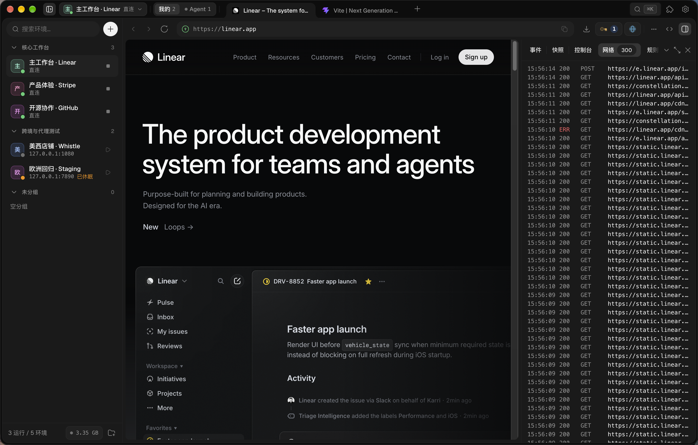
</picture>

<sub><i>Dark &amp; light adaptive preview — OpenBot flat-precision chrome, Kubai plugin icons, grouped environments, live websites (<code>linear.app</code> / <code>vercel.com</code>), and the right Workbench Inspector.</i></sub>

</div>

---

## Why Warren

> **Etymology** — A *warren* is a network of rabbit burrows: one interconnected system where **each burrow has its own entrance and exit**. Every Environment gets its own identity and network egress while living inside one shared workbench.

Most browser-automation setups split into two extremes: headless scripts you cannot watch or rescue mid-flight, or anti-detect fingerprint managers built around spoofed browser identities. Warren takes a different shape—**isolated environments, explicit addressing, and human-in-the-loop co-browsing**:

| Capability | What It Solves |
|---|---|
| **Per-Burrow Isolation** | Each **Environment** owns a partitioned Electron `Session` (cookies, `localStorage`, cache), independent HTTP/SOCKS/Whistle proxy, and per-environment X.509 `trustedCa` verification—without kernel patches or fingerprint spoofing. |
| **Dual Spaces, Shared Auth** | Every Environment contains a **Person Space** (always human-owned, no lease required) and an **Agent Space** (lease-gated). Both share the same login session and proxy egress while keeping separate tab sets that never collide—and releasing control keeps you right in your active view. |
| **Persistent Agent Session &amp; Ardia WebGL2 Shield** | Reading never requires a lease; writing acquires an `<env>` lease and enters a persistent Agent operating session (`acting` ↔ calm `thinking` across commands until `warren env finish <env>` or human intervention). A single-instance native `WebContentsView` shield renders a slow-flow **Ardia `PowerUp + Halo` WebGL2 physical light field** (Oklab 6-color spectrum, 3D Simplex Noise penumbra, hollow 4-strip edge geometry for zero center GPU cost) with a macOS Liquid Glass HUD, Dia gradient AI cursor, target lock box, and one-click **Take Over / Finish**. |
| **CLI + Auto-Synced Skills** | Designed for coding agents (`warren` CLI + compiled `SKILL.md` for `~/.agents`, `~/.claude`, `~/.codex`) with compact accessibility `@N` snapshots, batched Delta Receipts, and a locked `node:vm` scripting runtime. |

---

## Visual Tour

### Slow-Flow Ardia `PowerUp + Halo` WebGL2 Native AI Shield (Dark & Light)

When an agent drives `Agent Space`, Warren's native `shield` layer (`InputShield`) renders a slow-flow **Ardia `PowerUp + Halo` WebGL2 physical light field** directly above live pages (`linear.app` / `react.dev`)—combining Oklab perceptual spectrum blending, 3D Simplex Noise penumbra, hollow 4-strip perimeter geometry, a gradient AI arrow cursor, target lock-on box (`@N`), and a bottom-center macOS Liquid Glass HUD with one-click **Take Over** and **Finish**.

<table>
  <tr>
    <td width="100%">
      <picture>
        <source media="(prefers-color-scheme: dark)" srcset="./docs/screenshots/03-agent-shield-dark.png" />
        <source media="(prefers-color-scheme: light)" srcset="./docs/screenshots/04-agent-shield-light.png" />
        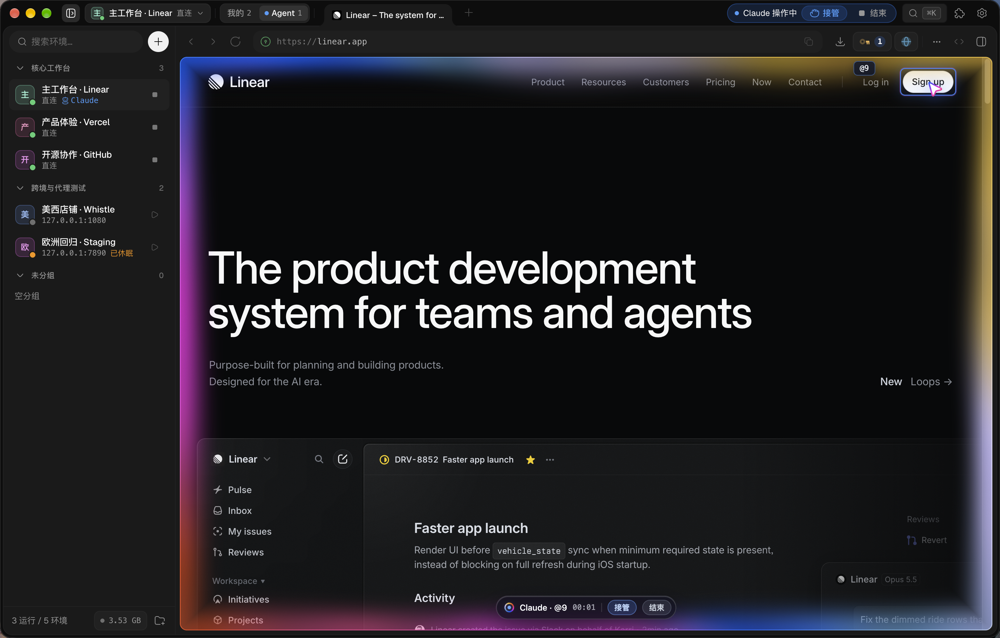
      </picture>
    </td>
  </tr>
</table>

<table>
  <tr>
    <td width="50%" valign="top">
      <a href="./docs/screenshots/07-devtools-bottom-workbench.png">
        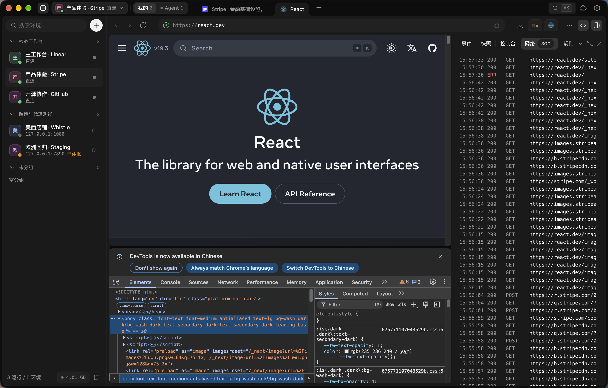
      </a>
      <br />
      <strong>Resizable Docked DevTools &amp; 3-Pane Coexist</strong>
      <br />
      <sub>Native Chrome DevTools (<code>right</code> / <code>bottom</code> / <code>detach</code>) with a draggable splitter coexists cleanly alongside <code>react.dev</code> and the <code>360px</code> Network Inspector—zero z-index clipping.</sub>
    </td>
    <td width="50%" valign="top">
      <a href="./docs/screenshots/06-simulated-viewport-mobile.png">
        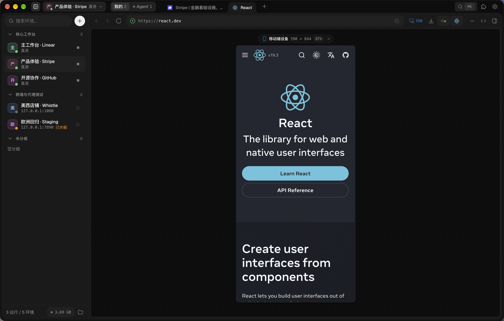
      </a>
      <br />
      <strong>Centered Simulated Viewport Studio</strong>
      <br />
      <sub>Preset sizes (<code>390×844</code> Mobile Touch, <code>1280×800</code>, <code>1440×900</code>) center smoothly on a dotted recessed canvas with real-time CDP <code>scale</code> fit, floating device pill, and one-click reset.</sub>
    </td>
  </tr>
  <tr>
    <td width="50%" valign="top">
      <a href="./docs/screenshots/05-agent-idle-readonly.png">
        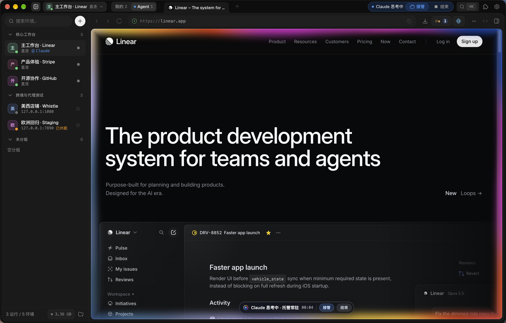
      </a>
      <br />
      <strong>Persistent Agent Session · Calm Thinking Mode</strong>
      <br />
      <sub>Between CLI commands, the write lock frees automatically while the Agent operating session smoothly shifts into a serene <code>thinking</code> glow—eliminating shield flicker until AI calls <code>warren env finish</code> or you click <strong>Take Over / Finish</strong>.</sub>
    </td>
    <td width="50%" valign="top">
      <a href="./docs/screenshots/09-workbench-snapshot-hn.png">
        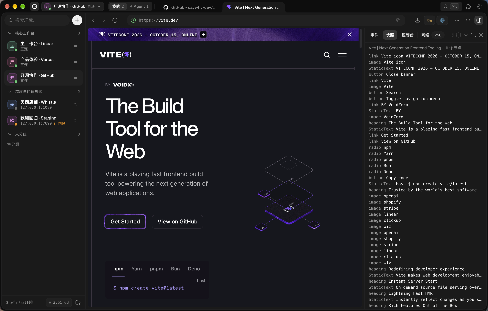
      </a>
      <br />
      <strong>Live AXTree Snapshot Inspector</strong>
      <br />
      <sub>Inspect what agents perceive on live sites like <code>vite.dev</code> (111 semantic accessibility nodes) directly beside the viewport, or jump to Console, Network, Rules, and Storage.</sub>
    </td>
  </tr>
  <tr>
    <td width="50%" valign="top">
      <a href="./docs/screenshots/10-workbench-accounts-tab.png">
        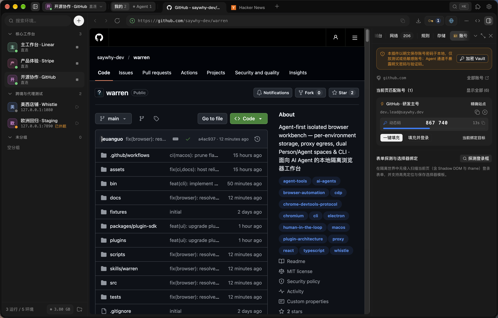
      </a>
      <br />
      <strong>Plugin Workbench Tabs &amp; Live 2FA TOTP</strong>
      <br />
      <sub>Contextual plugin tabs (such as <code>com.warren.accounts</code>) match current origins like <code>github.com</code> with live TOTP countdowns, selector binding, and one-click form autofill.</sub>
    </td>
    <td width="50%" valign="top">
      <a href="./docs/screenshots/11-command-palette.png">
        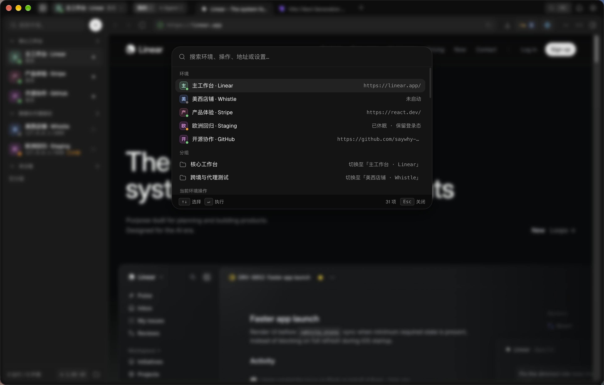
      </a>
      <br />
      <strong>Global Command Palette · <code>⌘K</code></strong>
      <br />
      <sub>Pre-warmed transparent <code>OverlayHost</code> floats cleanly above live <code>WebContentsView</code> pages for instant environment switching, actions, and plugin command-bar entries.</sub>
    </td>
  </tr>
</table>

<details>
<summary><strong>More Real-Site Captures: Right-Dock Exclusivity, Stopped Env Launchpad, Whistle Proxy, Accounts &amp; Memory Governance</strong></summary>

<table>
  <tr>
    <td width="50%" valign="top">
      <a href="./docs/screenshots/08-devtools-right-exclusive.png">
        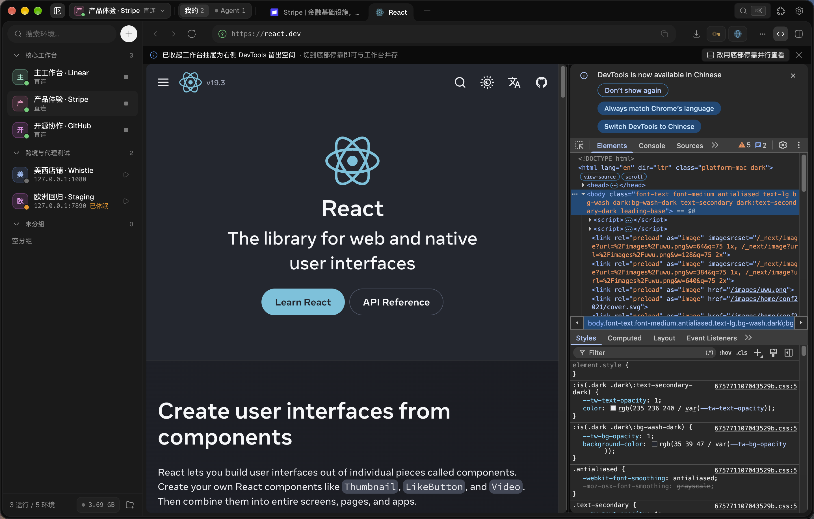
      </a>
      <br />
      <strong>Smart Right-Dock Exclusivity &amp; One-Click Bottom Switch</strong>
      <br />
      <sub>Docking DevTools on the right auto-collapses the Workbench drawer cleanly and offers a one-click jump to bottom coexist mode.</sub>
    </td>
    <td width="50%" valign="top">
      <a href="./docs/screenshots/12-stopped-env-cta.png">
        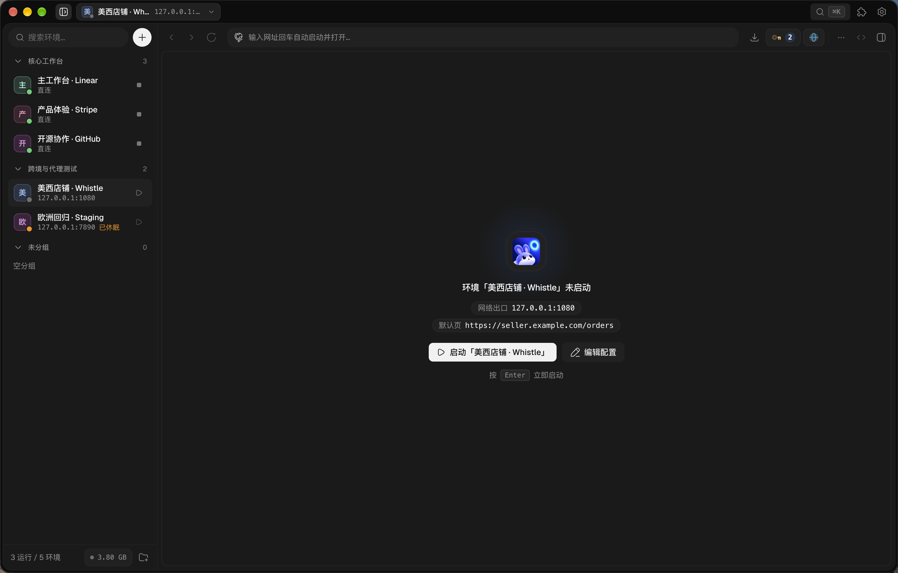
      </a>
      <br />
      <strong>Stopped Environment Launchpad</strong>
      <br />
      <sub>Shows per-environment egress proxy (<code>127.0.0.1:1080</code>) and start URL before booting with <code>Enter</code> or editing configuration.</sub>
    </td>
  </tr>
  <tr>
    <td width="50%" valign="top">
      <a href="./docs/screenshots/13-global-accounts-page.png">
        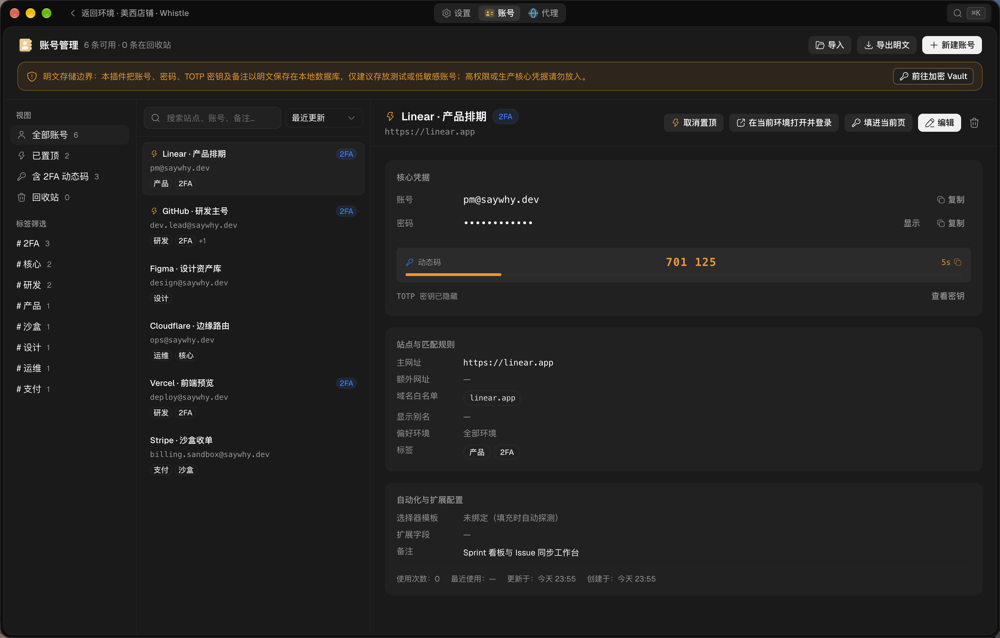
      </a>
      <br />
      <strong>Global Account Manager Workspace (<code>com.warren.accounts</code>)</strong>
      <br />
      <sub>Full-page keep-alive plugin view with tag filters, 2FA TOTP filter, domain matching rules, and explicit Vault migration callout.</sub>
    </td>
    <td width="50%" valign="top">
      <a href="./docs/screenshots/14-global-whistle-page.png">
        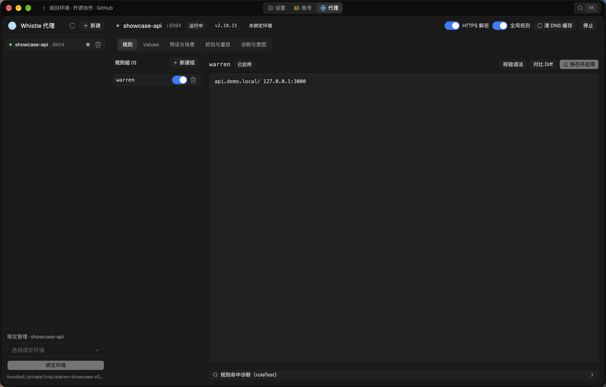
      </a>
      <br />
      <strong>Whistle Multi-Instance Proxy Workbench (<code>com.warren.whistle</code>)</strong>
      <br />
      <sub>Per-environment <code>whistle@2.10.15</code> instance binding, live <code>quickMock</code> / <code>injectFault</code> rule groups, syntax check, and <code>ruleTest</code> hit diagnostics.</sub>
    </td>
  </tr>
  <tr>
    <td width="50%" valign="top">
      <a href="./docs/screenshots/15-global-settings-general.png">
        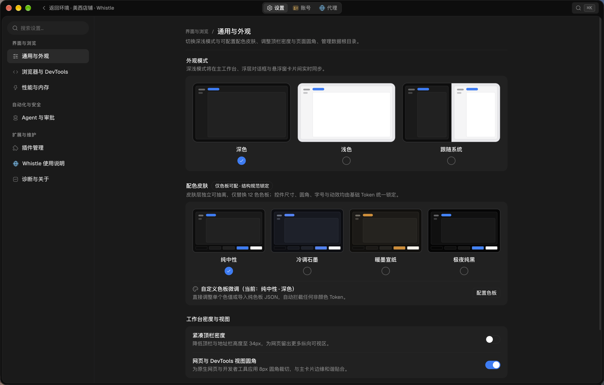
      </a>
      <br />
      <strong>Settings Center — Appearance &amp; Detachable Skin Engine</strong>
      <br />
      <sub>OpenBot flat-precision theme cards (Dark / Light / System) paired with 4 detachable color-only skins (Neutral, Cool Slate, Warm Ink, Pitch Black) and live custom palette tuning.</sub>
    </td>
    <td width="50%" valign="top">
      <a href="./docs/screenshots/16-global-settings-memory.png">
        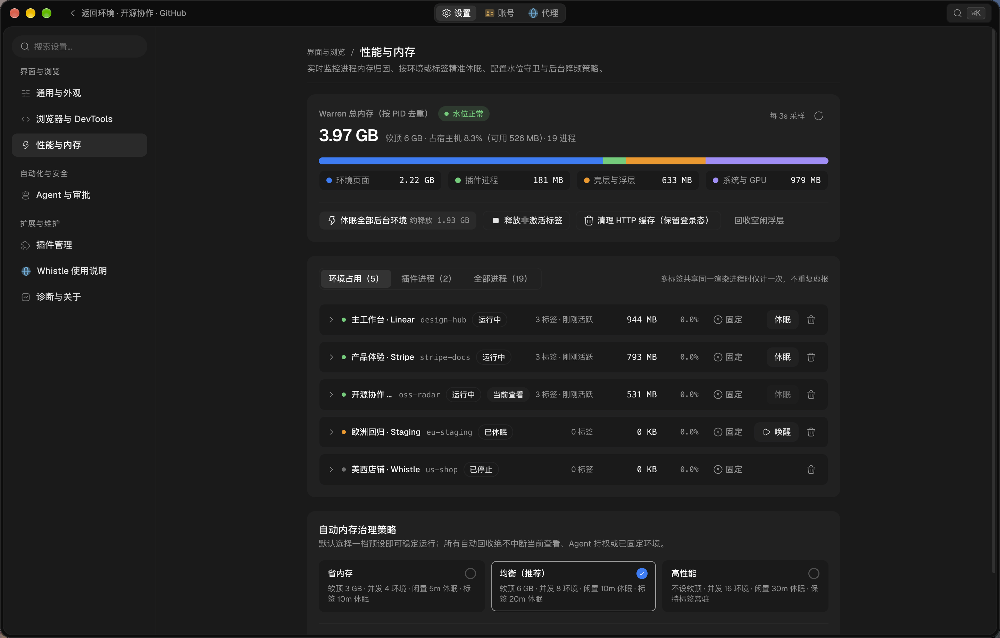
      </a>
      <br />
      <strong>Performance &amp; Real-Time Memory Governance</strong>
      <br />
      <sub>PID-deduplicated memory attribution across environments, plugins, shell, and GPU processes with one-click hibernate/wake, tab sleep, cache cleanup, and automated pressure policies.</sub>
    </td>
  </tr>
</table>

</details>

---

## Quick Start

### 1. Install macOS App (Unsigned / Ad-Hoc Build)

Download `Warren-<version>-arm64.dmg` or `Warren-darwin-arm64-<version>.zip` from [GitHub Releases](https://github.com/saywhy-dev/warren/releases) or the `warren-macos-arm64` artifact on the latest passing [`CI` workflow run](https://github.com/saywhy-dev/warren/actions/workflows/ci.yml) (Apple Silicon / macOS).

> [!IMPORTANT]
> **Unsigned macOS packages trigger Gatekeeper**
>
> Prebuilt installers currently use **ad-hoc signing** without an Apple Developer ID signature or notarization. Because browsers attach `com.apple.quarantine` to downloaded files, double-clicking `Warren.app` directly will make macOS show **`"Warren" is damaged and can't be opened`** (or `"Apple could not verify Warren"`). Clear the quarantine attribute once before opening:

**Option A — Install from `.dmg`:**

1. Open `Warren-0.3.0-arm64.dmg` and drag `Warren.app` into `/Applications` (if Gatekeeper warns before dragging, do not move to Trash).
2. Run in Terminal:

```bash
xattr -cr /Applications/Warren.app
open -a Warren
```

**Option B — Install from `.zip`:**

Extract with `ditto` into `/Applications` (preserves Electron bundle symlinks and permissions), clear quarantine, and launch:

```bash
ditto -xk Warren-darwin-arm64-0.3.0.zip /Applications
xattr -cr /Applications/Warren.app
open -a Warren
```

- If macOS still restricts execution, run `sudo xattr -rd com.apple.quarantine /Applications/Warren.app` (and optionally verify checksums with `shasum -a 256 -c SHA256SUMS.txt`).
- Installing `.dmg` / `.zip` gives you the Desktop App (`Warren.app`, which exposes `~/.warren/runtime/envd.sock` on launch). To expose the `warren` CLI globally on `PATH`, link it from a cloned checkout below.

### 2. Run from Source & Expose `warren` CLI

Prerequisites: **macOS** (Apple Silicon) + **Node.js `24+`** and `npm`.

```bash
git clone https://github.com/saywhy-dev/warren.git
cd warren
npm install
npm start                 # Starts Electron Core + local Unix socket RPC (~/.warren/runtime/envd.sock)
```

In a second terminal (optionally run `npm link` once to expose `warren` globally):

```bash
npm link                  # Optional: links `warren` -> bin/warren.mjs
warren env list
warren help
```

### 3. First Agent Loop

Every mutation explicitly names `<env>`—selecting a row in the sidebar never grants implicit write access.

```bash
# Create & boot an isolated environment (optional --proxy and --start-url)
warren env create dev --start-url=https://example.com
warren env start dev

# Acquire single-writer lease on Agent Space, open a page, read compact accessibility tree
warren env acquire dev --wait=5000
warren browser open dev https://example.com --read
warren browser snapshot dev -i -u --content-boundaries

# Batch actions with an automatic post-step Delta Receipt
warren batch dev --bail <<'EOF'
click @1
snapshot -i
EOF

# Finish the Agent operating session and dismiss the overlay shield
warren env finish dev
```

<details>
<summary><strong>Build & Package macOS Desktop Bundle Locally (<code>Warren.app</code> / <code>.dmg</code> / <code>.zip</code>)</strong></summary>

Make sure `npm start` is stopped before packaging so Vite build outputs in `.vite/` do not collide (see [docs/RELEASE.md](./docs/RELEASE.md)):

```bash
npm run make
# Outputs under out/make/:
#   out/make/dmg/arm64/Warren-0.1.0-arm64.dmg
#   out/make/zip/darwin/arm64/Warren-darwin-arm64-0.1.0.zip
```

Optional Apple signing & notarization (credentials are read exclusively from environment variables; when omitted, builds remain ad-hoc signed so recipients must run `xattr -cr /Applications/Warren.app` after download):

```bash
APPLE_ID=you@example.com \
APPLE_APP_SPECIFIC_PASSWORD=xxxx-xxxx-xxxx-xxxx \
APPLE_TEAM_ID=XXXXXXXXXX \
npm run make
```

</details>

---

## CLI & Agent Workflow

`warren` (`bin/warren.mjs` → `bin/cli.mjs` + `bin/commands/*.mjs`) drives the running desktop Core over `~/.warren/runtime/envd.sock`. Untrusted page content is sanitized against terminal escapes, bounded to `--max-output` (`12000` bytes by default, spilling overflow to `~/.warren/tmp/`), and optionally wrapped in randomized `--content-boundaries` nonces.

### Command Overview

| Group | Key Subcommands | Purpose |
|---|---|---|
| `env` | `list`, `create`, `start`, `stop`, `hibernate`, `wake`, `remove`, `update`, `select`, `acquire`, `renew`, `release`, `takeover`, `egress`, `doctor`, `move`, `reorder` | Environment lifecycle, proxy/CA updates, leases, diagnostics |
| `group` / `tab` | `group list\|create\|rename\|remove\|collapse` · `tab list\|new\|select\|close\|reopen` | Sidebar grouping and per-space tab management |
| `browser` | `open`, `snapshot`, `read`, `find`, `get`, `is`, `diff`, `click`, `fill`, `type`, `press`, `select`, `drag`, `drop`, `upload`, `download`, `wait`, `dialog`, `eval`, `frame`, `pdf`, `set`, `webmcp`, `vitals`, `a11y`, `react`, `console`, `network`, `screenshot`, `highlight`, `detect-login` | Isolated-world CDP control, actionability checks, a11y trees, telemetry |
| `batch` / `exec` | `batch <env> [--bail] [--no-changes]` · `exec <env>` (`--capabilities`) | Multi-step CLI pipelines with Delta Receipts; `node:vm` scripts |
| `net` | `rules`, `rule add\|enable\|disable\|remove`, `hits`, `body`, `passthrough`, `record`, `replay` | Built-in per-environment mocks, blocks, redirects, HAR record/replay |
| `notes` / `flow` | `notes get\|set\|append\|list\|rm` · `flow steps\|save\|run\|list\|show\|rm` | Per-domain agent notes (auto-injected into snapshots) & read-only GET flows |
| `vault` / `extension` | `vault list\|add\|remove\|fill` · `extension list\|add\|remove` · `shot diff` | SafeStorage secret autofill (stdin-only add), unpacked extensions, pixel diff |
| `plugin` / `skills` | `plugin list\|create\|install\|update\|enable\|disable\|grant\|run\|rpc\|logs\|config` · `skills status\|install\|refresh\|plugin` | v4 plugin lifecycle, dynamic skill synthesis, agent harness sync |
| `rpc` / meta | `methods`, `call`, `events`, `evidence capture`, `help`, `warren --skill` | Live introspection across all registered RPC endpoints |

<details>
<summary><strong>Sandboxed <code>warren exec</code> &amp; Agent Skill Sync Examples</strong></summary>

`warren exec` executes scripts inside a locked `node:vm` context exposing **only 5 globals** (`page`, `console`, `setTimeout`, `clearTimeout`, `emitResult`)—never `process`, `require`, `fs`, or raw network sockets:

```bash
warren exec dev <<'JS'
await page.goto('https://example.com');
const snap = await page.snapshot();
emitResult({ url: snap.url, interactiveCount: snap.nodes.length });
JS
warren exec --capabilities
```

Synchronize Warren's base skill and all enabled plugin skills (`SKILL.md` + `references/`) directly into your local agent directories (`~/.agents`, `~/.claude`, `~/.codex`):

```bash
warren skills status
warren skills refresh
warren --skill --base-only        # Base Warren manual only
warren --skill --plugin=<id>      # Single plugin manual
```

</details>

---

## Architecture

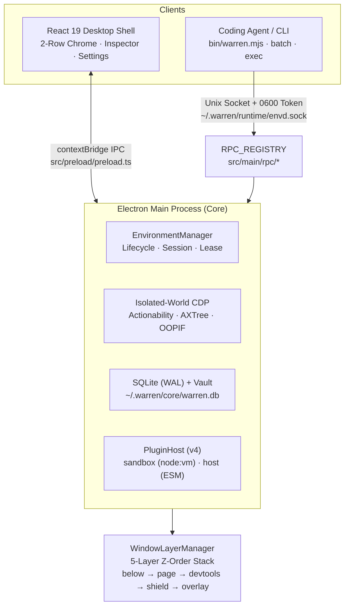

### Core Architectural Decisions

- **Two-Row Minimal Chrome + Keep-Alive Shell**:
  - **Row 1 (`40px`)**: Sidebar collapse (`⌘B`), environment pill, `Person | Agent` space switcher, tab strip, single lease/takeover pill (control release preserves the active view), `⌘K` command bar trigger, global settings.
  - **Row 2 (`40px`)**: Navigation, decomposed URL bar with one-click copy, omnibox history popover, plugin `statusBadge` / `popover` slots, zoom, centered/scaled simulated viewport presets (`390×844` / `1280×800` / `1440×900` over a dotted canvas), direct Downloads trigger, DevTools, and right Workbench Inspector toggle.
  - Switching to full-page Settings or a plugin `railPage` preserves live sidebar and page views with zero teardown.
- **5-Layer Native Window Stack ([`layer-order.ts`](src/main/ui/layer-order.ts))**: Every Chromium `WebContentsView` is ordered strictly by `below → page → devtools → shield → overlay` with unified `8px` corners—guaranteeing `OverlayHost` (`⌘K` / dialogs), `PopoverHost` (omnibox / downloads / find / plugin popovers), 3-layer WebGL `InputShield`, and resizable docked `DevToolsHost` (`right` / `bottom` draggable splitter + `detach`) never clip or occlude each other.
- **Clean Telemetry & Anti-Detection Hygiene**: Warren never keeps `Runtime.enable` or `Network.enable` permanently attached. Console and network logs come from Electron's native `console-message` and `webRequest` hooks and persist per tab in SQLite (`warren.db`, retained across stop/hibernate and purged on `env remove`). CSS/XPath locators run inside `Page.createIsolatedWorld` rather than polluting page globals.
- **Right Workbench Inspector & 6+N Settings**: On-demand `360px` drawer bundling 6 built-in tabs (`events`, `snapshot`, `console`, `network`, `rules`, `storage`) + plugin `inspectorTab` contributions, paired with a searchable 6-section Settings center (`general`, `browser`, `agent`, `vault`, `plugins`, `diagnostics`) + plugin `settingsSection` contributions and light/dark (`#181b21`) theming.

---

## Security & Data Boundaries

Everything Warren persists lives under a single configurable data root (`WARREN_HOME`, defaulting to `~/.warren`, defined symmetrically in [`src/main/paths.ts`](src/main/paths.ts) and [`bin/paths.mjs`](bin/paths.mjs)):

```text
~/.warren/
├── app/                   # Electron shell Chromium userData
├── core/
│   ├── warren.db          # Unified SQLite WAL DB (envs, groups, history, telemetry, notes, flows, vault)
│   ├── sessions/<env>/    # Partitioned browser storage per Environment
│   └── plugins/<id>/      # Installed plugin bundles + isolated plugin data.db
├── runtime/
│   ├── envd.sock          # Local Unix socket RPC server
│   └── runtime.json       # Ephemeral 0600 auth token
└── whistle/               # Shared Whistle root CA & per-instance state (WHISTLE_PATH)
```

- **Encrypted Vault without Reveal**: Credentials are encrypted via Electron `safeStorage`. `warren vault add <provider> --label=<name>` reads secrets **strictly from `stdin`** (never `argv`). External callers can only invoke `vault.list` (`ref` + masked `usernameHint`) and domain-checked `vault.fill`—prototype keys (e.g., `"toString"`) are rejected, and there is no plaintext `reveal` API.
- **Per-Environment CA & Proxy Auth**: Setting `EnvironmentConfig.trustedCa` verifies leaf certificates with `X509Certificate.verify` inside that environment's `Session` only; proxy auth in `app.on('login')` denies immediately if no matching credential exists.
- **Human-Only Approval Policy**: `controlPolicy` and per-environment `approval` rules can only be mutated via the desktop IPC channel—never via CLI/RPC.

---

## Plugin System (v4)

Warren plugins are standard npm packages declaring metadata under `package.json#warren` (`apiVersion: "4"`), typed by [`@warren/plugin-sdk`](./packages/plugin-sdk/index.d.ts). See [`plugins/README.md`](./plugins/README.md) for the full authoring guide.

- **Subprocess Execution with Hard Timeout**: Both `runtime: "sandbox"` (restricted `node:vm` inside a worker process—no `require`, `fs`, or `process`) and `runtime: "host"` (full Node ESM worker process) run inside killable child processes (`utilityProcess.fork` / `child_process.fork`) enforced by a `30_000ms` default kill timeout (`WARREN_PLUGIN_TIMEOUT_MS`). Neither runtime is an OS-level malware sandbox—only install trusted plugins.
- **8 Fail-Closed UI Surfaces**: Zero-build frontend ESM (`warren-plugin://<id>/app.js`) reuses host `app.ui`, `app.shell`, and `app.host` across `railPage`, `settingsSection`, `inspectorTab`, `envAction`, `envBadge`, `popover`, `statusBadge`, and `commandBarAction`.
- **Automatic Skill Injection**: Enabled plugins synthesize `SKILL.md` and `references/` (capped at `32KB` per plugin) into the main Warren agent skill automatically.

### Three-Tier Permission Model

Single source of truth in [`src/shared/permissions.ts`](src/shared/permissions.ts) (`19` total permissions):

| Tier | Permissions | Policy |
|---|---|---|
| `granted` (`6`) | `environment.read`, `browser.dom.read`, `browser.screenshot`, `ui.mount`, `storage.write`, `rpc.serve` | Granted on install |
| `confirm` (`8`) | `environment.write`, `browser.navigate`, `browser.input`, `vault.fill`, `network.observe`, `network.fetch`, `storage.cookie.port`, `events.subscribe` | Requires explicit user approval (`warren plugin grant` or UI prompt) |
| `denied` (`5`) | `browser.evaluate`, `storage.cookie.read`, `storage.cookie.write`, `process.spawn`, `filesystem.read` | **Permanently denied**, ignored even if declared |

### Bundled & Example Plugins

| Plugin | ID | Runtime | Highlights |
|---|---|---|---|
| **Whistle Proxy** | `com.warren.whistle` | `host` | Isolated `whistle@2.10.15` instances per environment (`46` commands, `7` UI surfaces): HTTPS traffic capture, `quickMock` / `injectFault` / `mapLocal` intent groups, redacted replay diff, cURL export, and preflight doctor. |
| **Account Manager** | `com.warren.accounts` | `sandbox` | Zero-selector login autofill + RFC 6238 TOTP (`16` commands, `5` UI surfaces). **Explicit product exception**: stores test credentials in plaintext in its own `data.db` with persistent UI warnings; agent channels never receive plaintext passwords/TOTP and enforce non-empty domain allowlists. |
| **Notes** | `com.example.notes` | `sandbox` | Per-environment & global agent memory/todo store (`9` commands, `5` UI surfaces). |
| **Login / Cookies / Host** | `com.example.{login,cookies,hosty}` | `sandbox` / `host` | Minimal reference plugins demonstrating `vault.fill`, metadata-only `storage.cookie.port`, and host Node runtime. |

```bash
# Install & use a bundled plugin
warren plugin install path:plugins/whistle
warren plugin enable com.warren.whistle
warren plugin run com.warren.whistle presetPreview --input='{"storage":"<instance>","scenario":"test"}'
warren plugin run com.warren.whistle presetApply --input='{"storage":"<instance>","scenario":"test","expectedHash":"<preview-hash>"}'
```

---

## Project Layout & Development

```text
warren/
├── bin/                   Agent CLI entrypoint (warren.mjs) & domain commands/*.mjs
├── src/
│   ├── shared/            Cross-process contracts (permissions.ts, plugin-host-api.ts, types/*.ts)
│   ├── main/              Electron Core: env/, ui/ (5-layer stack), browser/, net/, plugins/, rpc/, store/, vault/
│   ├── preload/           Type-safe contextBridge IPC preload
│   └── renderer/          React 19 + Vite 8 + Tailwind v4 + base-ui desktop shell
├── packages/plugin-sdk/   @warren/plugin-sdk TypeScript package contract
├── plugins/               Official & reference plugins (whistle, account-manager, example-*)
├── skills/warren/         Built-in Warren Agent Skill template
├── tests/                 Node unit tests (71 files) + Vitest/happy-dom UI tests (tests/ui/)
├── scripts/               Fixture server, changed-test selector, and regression suite
└── docs/                  Architecture plans, product specs, UI design language & handoff
```

### Verification Commands

```bash
npm run check:changed             # Daily workflow: oxlint + prettier + tsc + git-diff headless tests
npm run test:ui                   # Headless React UI test suite (Vitest + happy-dom)
npm run check                     # Full headless CI gate: lint, format, typecheck, unit + UI tests, Vite build
npx tsc -p tsconfig.check.json    # Full typecheck across src/, tests/, and @warren/plugin-sdk
```

### Documentation Map

| Topic | Document |
|---|---|
| Docs index & reading order | [`docs/README.md`](./docs/README.md) |
| Architecture decisions & current state | [`docs/HANDOFF.md`](./docs/HANDOFF.md) |
| Product requirements & CLI contracts | [`docs/PRD.md`](./docs/PRD.md) |
| Tech stack rationale | [`docs/TECH-STACK-RESEARCH.md`](./docs/TECH-STACK-RESEARCH.md) |
| Design system & component contract | [`docs/ui-design-language.md`](./docs/ui-design-language.md) |
| Plugin authoring guide & SDK | [`plugins/README.md`](./plugins/README.md) · [`packages/plugin-sdk/README.md`](./packages/plugin-sdk/README.md) |
| Build, signing & notarization | [`docs/RELEASE.md`](./docs/RELEASE.md) |

---

## License

Licensed under the [MIT License](./LICENSE).
