<div align="center">


# Warren

**面向 AI Agent 的本地隔离浏览器工作台——每个环境独立身份、独立代理出口与双空间协同。**

一个 Electron 桌面端与原生 CLI 工作台：每个 **Environment** 拥有隔离的 Chromium 存储、独立代理与 CA 信任边界，以及受单写者租约（Lease）保护的 **Person / Agent** 双空间。

[English](./README.md) · **简体中文** · [快速开始](#快速开始) · [界面实机预览](#界面实机预览) · [CLI 与 Agent 工作流](#cli-与-agent-工作流) · [系统架构](#系统架构) · [插件体系](#插件体系v4) · [文档导航](./docs/README.md)

<p>
  <a href="https://github.com/saywhy-dev/warren/actions/workflows/ci.yml"></a>
  
  
  
  <a href="#快速开始"></a>
  <a href="./LICENSE"></a>
</p>

<br />

<picture>
  <source media="(prefers-color-scheme: dark)" srcset="./docs/screenshots/01-workbench-dark.png" />
  <source media="(prefers-color-scheme: light)" srcset="./docs/screenshots/02-workbench-light.png" />
  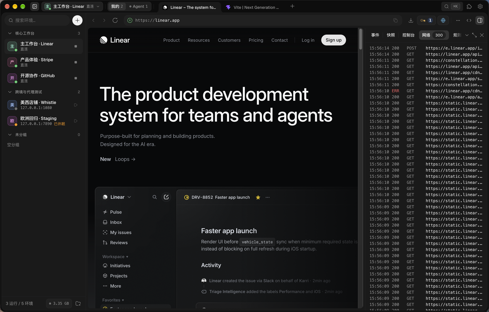
</picture>

<sub><i>深浅主题自适应预览：OpenBot 扁平精密设计体系、Kubai 插件品牌图标、分组环境树、真实美观站点（<code>linear.app</code> / <code>vercel.com</code>）与右侧随行工作台检查器。</i></sub>

</div>

---

## 为什么做 Warren

> **名字的由来**：*warren* 指兔子的地下洞穴网络——一整片相互连通的地道，**但每个洞口都有独立的出入口**。在 Warren 中，每一个 Environment 都拥有自己独立的浏览器身份与网络出口，同时共处于同一个工作台系统内。

现有的浏览器自动化往往走向两个极端：要么是黑盒跑完、出错时无从观察与接管的无头脚本；要么是围绕「浏览器指纹伪装」构建的反检测管理器。Warren 选择了另一种结构——**环境与代理隔离、显式寻址、人机同屏协同**：

| 核心能力 | 解决什么问题 |
|---|---|
| **环境级完全隔离** | 每个 **Environment** 拥有独立分区的 Electron `Session`（Cookie、`localStorage`、缓存）、独立 HTTP / SOCKS / Whistle 代理出口，以及环境级 X.509 `trustedCa` 验签——不魔改内核，也不做指纹伪装。 |
| **同会话双空间（Person / Agent）** | 同一环境内共享登录态与代理出口，但分离为 **Person Space**（永远由人控制、免 lease）与 **Agent Space**（受单写者租约约束）两套独立标签工作区，人与 Agent 并行操作互不碰撞；交还控制权时保持当前视角，不强制跳回。 |
| **常驻托管态 + Ardia WebGL2 物理光场护盾** | 读操作免 lease，写操作显式指定 `<env>` 并进入常驻托管操作态（命令间隙自动释放写锁并平滑切入舒缓 `thinking` 态，彻底消除蒙层闪烁，直到调用 `warren env finish <env>` 或人工干预退出）。全局单实例原生 `WebContentsView` 护盾采用**慢流速 Ardia `PowerUp + Halo` WebGL2 物理光场**（Oklab 6 色光谱、3D Simplex 噪声宽柔半影、空心四边几何体裁剪零中心开销），搭配 macOS 液态玻璃 HUD、渐变 AI 光标、目标锁定框与一键「接管 / 结束」。 |
| **CLI + 自动合成 Skill** | 专为 Coding Agent 打造（`warren` CLI + 自动同步至 `~/.agents`、`~/.claude`、`~/.codex` 的 `SKILL.md`），提供紧凑可读的无障碍树 `@N` 快照、带 Delta Receipt 的 `batch` 批处理与受限 `node:vm` 脚本运行时。 |

---

## 界面实机预览

### 慢流速 Ardia `PowerUp + Halo` WebGL2 原生 AI 护盾（深色 / 浅色自适应）

当 Agent 托管操作 `Agent Space` 时，原生 `shield` 视窗层（`InputShield`）在真实网页（`linear.app` / `react.dev`）上方叠加慢流速 **Ardia `PowerUp + Halo` WebGL2 物理光场**——融合 Oklab 光谱混色、3D Simplex Noise 宽幅半影、空心四边裁剪几何体、渐变 AI 箭头光标、目标锚框（`@N`）与底部居中 macOS 液态玻璃 HUD 胶囊，兼顾极高通透度与一键「接管 / 结束」。

<table>
  <tr>
    <td width="100%">
      <picture>
        <source media="(prefers-color-scheme: dark)" srcset="./docs/screenshots/03-agent-shield-dark.png" />
        <source media="(prefers-color-scheme: light)" srcset="./docs/screenshots/04-agent-shield-light.png" />
        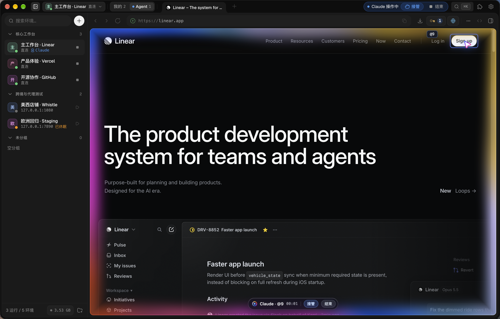
      </picture>
    </td>
  </tr>
</table>

<table>
  <tr>
    <td width="50%" valign="top">
      <a href="./docs/screenshots/07-devtools-bottom-workbench.png">
        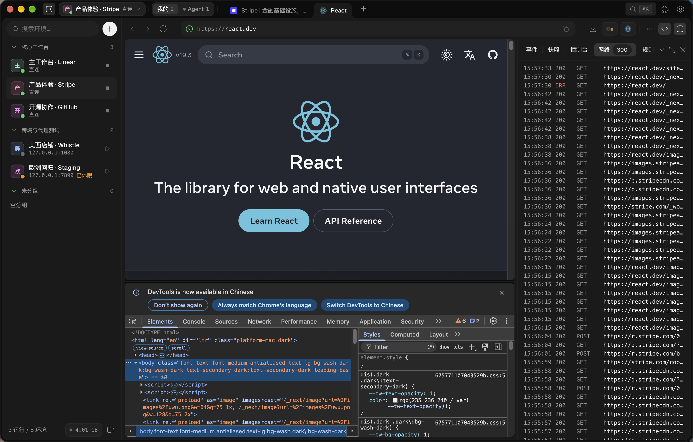
      </a>
      <br />
      <strong>可拖拽停靠式 DevTools &amp; 三区并行工作台</strong>
      <br />
      <sub>原生 Chrome DevTools（支持 <code>right</code> / <code>bottom</code> 拖拽改大小与 <code>detach</code> 独立窗）可与 <code>react.dev</code> 网页视图及 <code>360px</code> 右侧检查器稳定共存，零 DOM 叠层遮挡。</sub>
    </td>
    <td width="50%" valign="top">
      <a href="./docs/screenshots/06-simulated-viewport-mobile.png">
        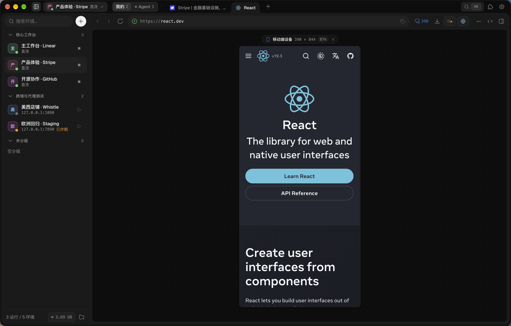
      </a>
      <br />
      <strong>居中模拟视口画布 · 等比缩放</strong>
      <br />
      <sub>选择预设尺寸（<code>390×844</code> 移动触控 / <code>1280×800</code> / <code>1440×900</code>）后视图自动在点阵下沉画布中对称居中，联动 CDP <code>scale</code> 实时微缩并配顶部悬浮胶囊与一键还原。</sub>
    </td>
  </tr>
  <tr>
    <td width="50%" valign="top">
      <a href="./docs/screenshots/05-agent-idle-readonly.png">
        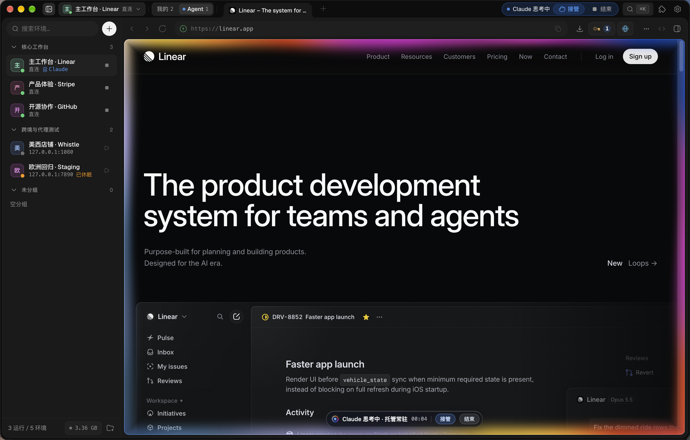
      </a>
      <br />
      <strong>常驻托管会话态 · 思考期不闪烁</strong>
      <br />
      <sub>单条 CLI 命令结束后底层写锁即时释放，护盾平滑收敛至舒缓 <code>thinking</code> 常驻光场（底部胶囊显示「思考中 · 托管常驻」），直至 AI 调 <code>warren env finish</code> 或人点「接管 / 结束」才退场。</sub>
    </td>
    <td width="50%" valign="top">
      <a href="./docs/screenshots/09-workbench-snapshot-hn.png">
        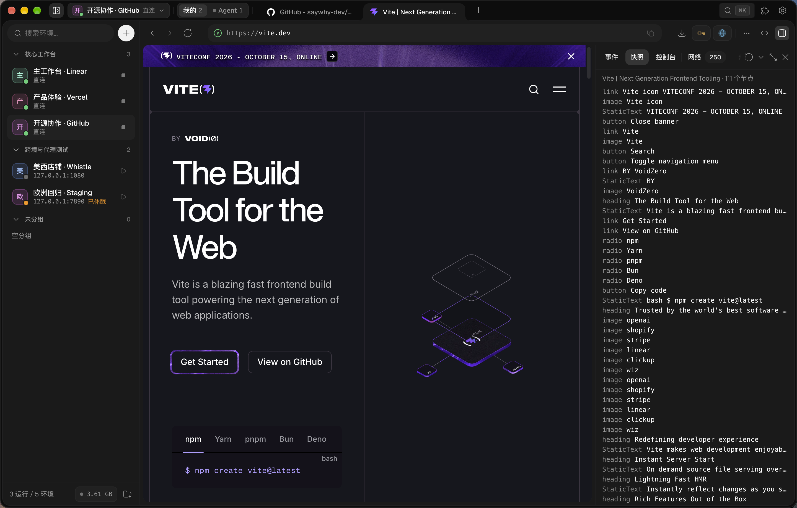
      </a>
      <br />
      <strong>真实网站实时无障碍快照面板</strong>
      <br />
      <sub>在 <code>vite.dev</code> 等真实站点旁一键读取页面语义无障碍节点树（111 个节点），并与事件、控制台、网络、规则和存储面板随时切换对照。</sub>
    </td>
  </tr>
  <tr>
    <td width="50%" valign="top">
      <a href="./docs/screenshots/10-workbench-accounts-tab.png">
        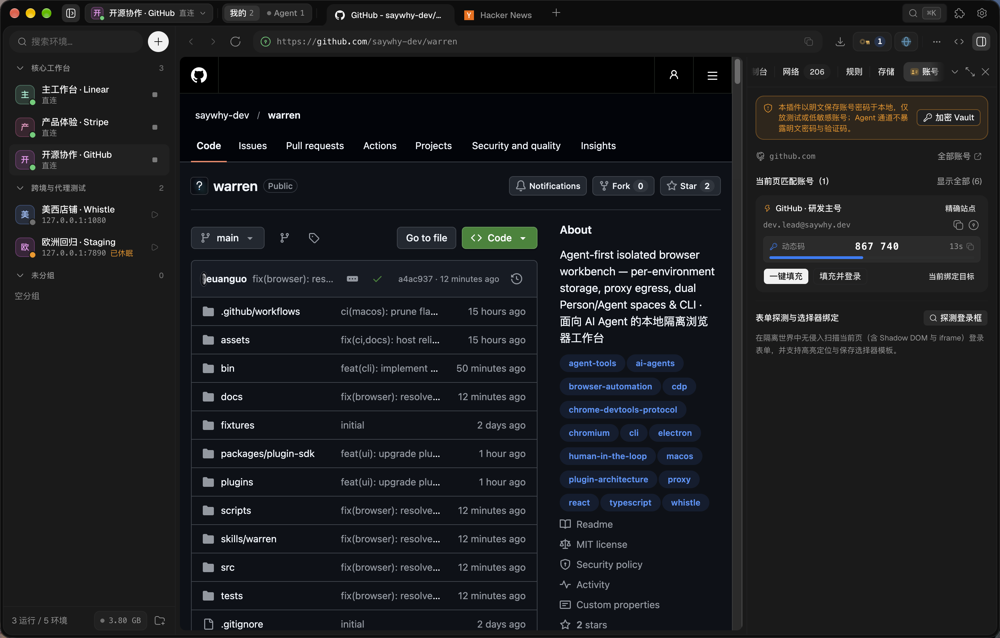
      </a>
      <br />
      <strong>插件随行工作台 &amp; 实时 2FA 动态码</strong>
      <br />
      <sub>插件 <code>inspectorTab</code>（如 <code>com.warren.accounts</code>）按域名智能匹配 <code>github.com</code> 账号，内置 2FA 倒计时动态码与零手写选择器一键登录填充。</sub>
    </td>
    <td width="50%" valign="top">
      <a href="./docs/screenshots/11-command-palette.png">
        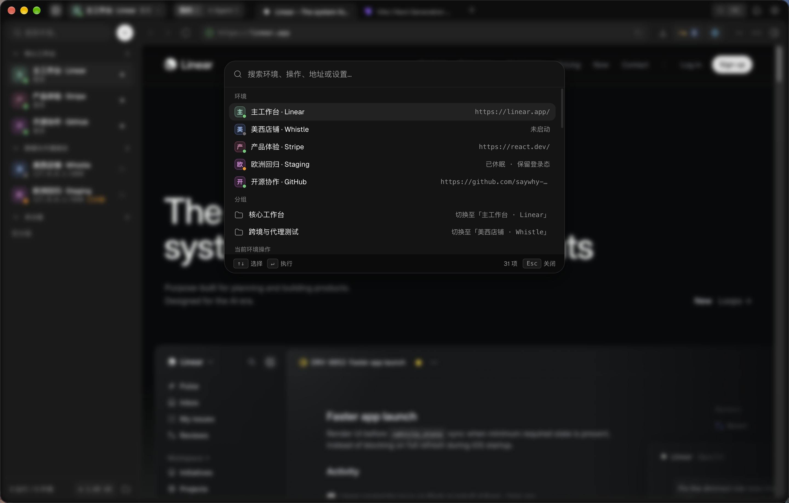
      </a>
      <br />
      <strong>全局命令面板 · <code>⌘K</code></strong>
      <br />
      <sub>预热透明顶层窗 <code>OverlayHost</code> 浮于真实网页视图之上毫秒级响应，支持即时检索环境、分组、页面动作与插件命令栏入口。</sub>
    </td>
  </tr>
</table>

<details>
<summary><strong>更多实机截图：右侧互斥横幅、未启动引导页、Whistle 代理台、全局账号与外观 / 内存治理</strong></summary>

<table>
  <tr>
    <td width="50%" valign="top">
      <a href="./docs/screenshots/08-devtools-right-exclusive.png">
        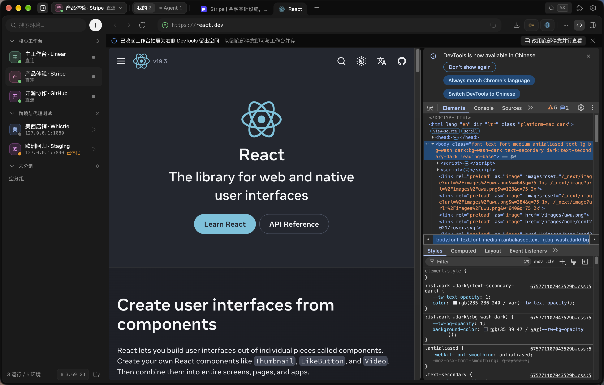
      </a>
      <br />
      <strong>右侧停靠智能互斥 &amp; 一键改用底部停靠</strong>
      <br />
      <sub>右侧停靠 DevTools 时自动让位工作台抽屉，并在网页上方给出清楚提示与一键切到底部并行按钮。</sub>
    </td>
    <td width="50%" valign="top">
      <a href="./docs/screenshots/12-stopped-env-cta.png">
        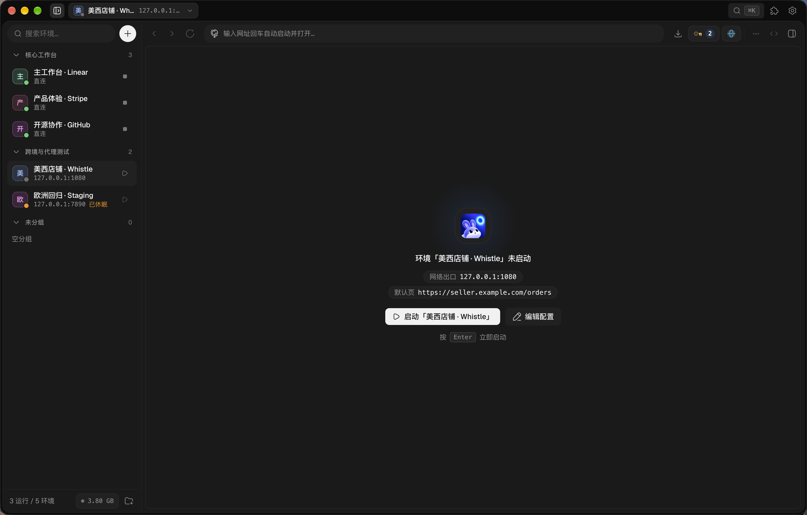
      </a>
      <br />
      <strong>未启动环境引导页</strong>
      <br />
      <sub>清晰展示该环境配置的独立代理出口（<code>127.0.0.1:1080</code>）与默认启动页，支持按 <code>Enter</code> 或点击一键启动。</sub>
    </td>
  </tr>
  <tr>
    <td width="50%" valign="top">
      <a href="./docs/screenshots/13-global-accounts-page.png">
        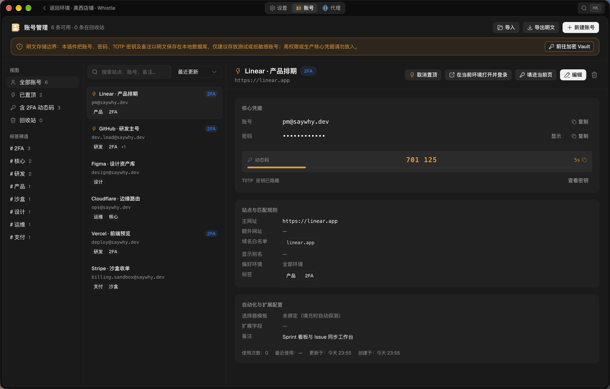
      </a>
      <br />
      <strong>全局账号管理页（<code>com.warren.accounts</code>）</strong>
      <br />
      <sub>全局保活全屏插件页：支持标签筛选、含 2FA 筛选、域名匹配策略编辑以及显式的 Vault 加密迁移引导。</sub>
    </td>
    <td width="50%" valign="top">
      <a href="./docs/screenshots/14-global-whistle-page.png">
        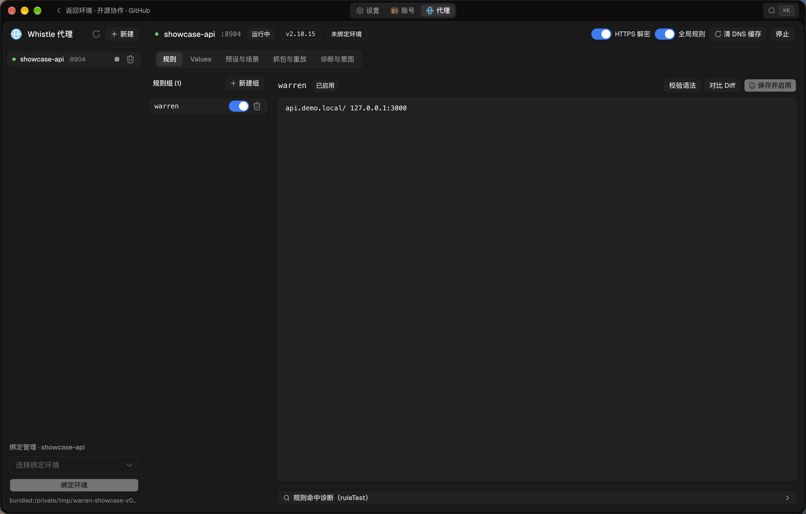
      </a>
      <br />
      <strong>全局 Whistle 多实例代理台（<code>com.warren.whistle</code>）</strong>
      <br />
      <sub>为环境绑定独立 <code>whistle@2.10.15</code> 实例，实时管理 Mock / 故障注入规则组、语法校验、Diff 对比与 <code>ruleTest</code> 命中诊断。</sub>
    </td>
  </tr>
  <tr>
    <td width="50%" valign="top">
      <a href="./docs/screenshots/15-global-settings-general.png">
        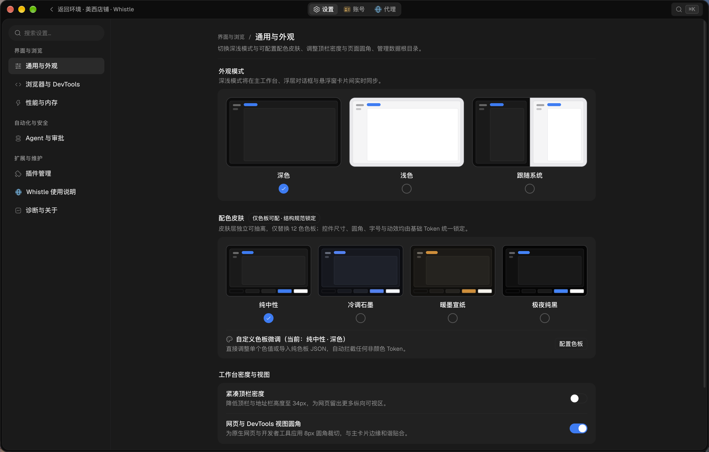
      </a>
      <br />
      <strong>设置中心 —— 通用与可抽离配色皮肤引擎</strong>
      <br />
      <sub>深色 / 浅色 / 跟随系统三卡预览搭配 4 套可抽离纯色板皮肤（纯中性、冷调石墨、暖墨宣纸、极夜纯黑）与实时自定义色板微调，全壳层、DevTools 与浮层同步生效。</sub>
    </td>
    <td width="50%" valign="top">
      <a href="./docs/screenshots/16-global-settings-memory.png">
        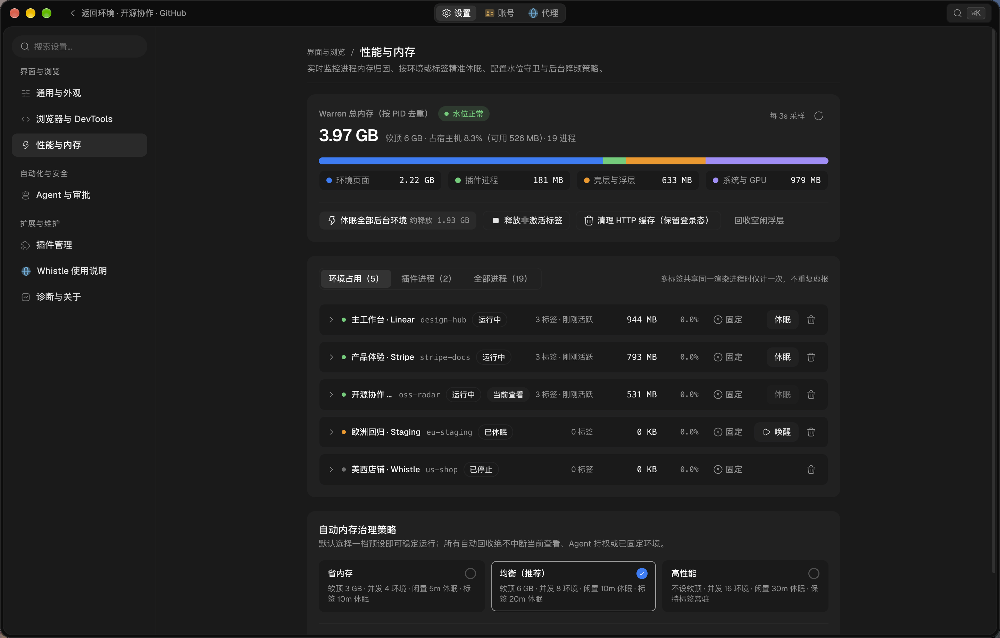
      </a>
      <br />
      <strong>性能与实时内存治理面板</strong>
      <br />
      <sub>按 PID 去重实时归因环境页面、插件进程、壳层与 GPU 内存占用，支持单环境固定 / 休眠 / 唤醒、空闲标签释放、缓存清理与自动化内存水位策略。</sub>
    </td>
  </tr>
</table>

</details>

---

## 快速开始

### 1. 安装 macOS 客户端（未签名包必读）

前往 [GitHub Releases](https://github.com/saywhy-dev/warren/releases) 或最新一次通过的 [`CI` 工作流运行记录](https://github.com/saywhy-dev/warren/actions/workflows/ci.yml) 页面底部的 `warren-macos-arm64` 构建产物（Artifacts），下载 `Warren-<version>-arm64.dmg` 或 `Warren-darwin-arm64-<version>.zip`（Apple Silicon / macOS）。

> [!IMPORTANT]
> **未签名包在 macOS 上会触发 Gatekeeper 拦截，必须先执行去隔离命令**
>
> 当前安装包仅使用 **ad-hoc 签名**，尚未进行 Apple Developer ID 签名与公证（Notarization）。从浏览器下载后系统会附带 `com.apple.quarantine` 隔离属性，直接双击打开会报错 **“Warren”已损坏，无法打开** 或 **无法验证开发者**。安装后请在终端执行一次以下命令即可正常启动：

**方式 A：从 `.dmg` 安装**

1. 打开 `Warren-0.3.0-arm64.dmg`，将 `Warren.app` 拖入 `/Applications`（若系统提示警告，先关闭弹窗，不要移到废纸篓）。
2. 在终端运行：

```bash
xattr -cr /Applications/Warren.app
open -a Warren
```

**方式 B：从 `.zip` 命令行安装**

建议使用 `ditto` 直接解压进 `/Applications`（完整保留 Electron 包内符号链接与权限），清除隔离属性后启动：

```bash
ditto -xk Warren-darwin-arm64-0.3.0.zip /Applications
xattr -cr /Applications/Warren.app
open -a Warren
```

- 若系统安全策略仍拦截，可执行显式清除隔离属性命令：`sudo xattr -rd com.apple.quarantine /Applications/Warren.app`（也可用 `shasum -a 256 -c SHA256SUMS.txt` 校验安装包完整性）。
- 安装 `.dmg` / `.zip` 提供桌面端 `Warren.app`（启动后自动提供 `~/.warren/runtime/envd.sock`）。若还需在终端全局使用 `warren` CLI，按下方第 2 步从仓库执行 `npm link`。

### 2. 从源码运行与安装全局 CLI

运行环境：**macOS**（Apple Silicon）+ **Node.js `24+`** 与 `npm`。

```bash
git clone https://github.com/saywhy-dev/warren.git
cd warren
npm install
npm start                 # 启动 Electron Core + 本地 Unix Socket RPC (~/.warren/runtime/envd.sock)
```

在另一个终端中（可选执行一次 `npm link` 将 `warren` 安装到全局 `PATH`）：

```bash
npm link                  # 可选：链接全局 warren -> bin/warren.mjs
warren env list
warren help
```

### 3. 第一条 Agent 操作闭环

每次写入都必须显式传入 `<env>`——在左侧列表选中环境不会隐式授予写权限。

```bash
# 创建并启动隔离环境（可附带 --proxy 与 --start-url）
warren env create dev --start-url=https://example.com
warren env start dev

# 申请 Agent Space 单写者租约，打开页面并获取紧凑无障碍树快照
warren env acquire dev --wait=5000
warren browser open dev https://example.com --read
warren browser snapshot dev -i -u --content-boundaries

# 一次下发多步操作，自动返回附带新 @N 的 Delta Receipt
warren batch dev --bail <<'EOF'
click @1
snapshot -i
EOF

# 任务全部完成后显式结束 Agent 托管态并撤除蒙层
warren env finish dev
```

<details>
<summary><strong>从源码本地打包 macOS 安装包（<code>Warren.app</code> / <code>.dmg</code> / <code>.zip</code>）</strong></summary>

打包前请确保已停止 `npm start`，避免两套 Vite 进程同时写入 `.vite/` 目录（详见 [docs/RELEASE.md](./docs/RELEASE.md)）：

```bash
npm run make
# 产物输出在 out/make/ 目录：
#   out/make/dmg/arm64/Warren-0.1.0-arm64.dmg
#   out/make/zip/darwin/arm64/Warren-darwin-arm64-0.1.0.zip
```

如需启用 Apple 签名与公证（凭据仅从环境变量读取，不落仓库；未配置时打出的是未签名包，分发给他人时需提醒对方在安装后执行上文 `xattr -cr /Applications/Warren.app`）：

```bash
APPLE_ID=you@example.com \
APPLE_APP_SPECIFIC_PASSWORD=xxxx-xxxx-xxxx-xxxx \
APPLE_TEAM_ID=XXXXXXXXXX \
npm run make
```

</details>

---

## CLI 与 Agent 工作流

`warren`（`bin/warren.mjs` → `bin/cli.mjs` + `bin/commands/*.mjs`）通过 `~/.warren/runtime/envd.sock` 与桌面端 Core 通信。来自第三方的不可信网页正文会默认经过终端转义净化，按 `--max-output`（默认 `12000` 字节，溢出写入 `~/.warren/tmp/`）裁剪，并支持以 `--content-boundaries` 随机 nonce 边界隔离输出。

### 命令家族一览

| 命令组 | 主要子命令 | 用途 |
|---|---|---|
| `env` | `list`, `create`, `start`, `stop`, `hibernate`, `wake`, `remove`, `update`, `select`, `acquire`, `renew`, `release`, `takeover`, `egress`, `doctor`, `move`, `reorder` | 环境生命周期、代理与 CA 变更、租约控制与排障体检 |
| `group` / `tab` | `group list\|create\|rename\|remove\|collapse` · `tab list\|new\|select\|close\|reopen` | 侧栏环境分组与双空间内标签页管理 |
| `browser` | `open`, `snapshot`, `read`, `find`, `get`, `is`, `diff`, `click`, `fill`, `type`, `press`, `select`, `drag`, `drop`, `upload`, `download`, `wait`, `dialog`, `eval`, `frame`, `pdf`, `set`, `webmcp`, `vitals`, `a11y`, `react`, `console`, `network`, `screenshot`, `highlight`, `detect-login` | 隔离世界 CDP 操控、可操作性等待、a11y 结构读取与性能遥测 |
| `batch` / `exec` | `batch <env> [--bail] [--no-changes]` · `exec <env>` (`--capabilities`) | 带 Delta Receipt 的原子批处理；受限 `node:vm` 编排脚本 |
| `net` | `rules`, `rule add\|enable\|disable\|remove`, `hits`, `body`, `passthrough`, `record`, `replay` | 内置环境级 Mock、拦截、重定向与 HAR 录制重放 |
| `notes` / `flow` | `notes get\|set\|append\|list\|rm` · `flow steps\|save\|run\|list\|show\|rm` | 自动注入快照的域名记忆，以及只读参数化 GET 接口复用流 |
| `vault` / `extension` | `vault list\|add\|remove\|fill` · `extension list\|add\|remove` · `shot diff` | `safeStorage` 凭据直填（仅 stdin 录入）、解包扩展加载与截图差分 |
| `plugin` / `skills` | `plugin list\|create\|install\|update\|enable\|disable\|grant\|run\|rpc\|logs\|config` · `skills status\|install\|refresh\|plugin` | v4 插件包管理、命令/RPC 调用与本地 Agent Skill 同步 |
| `rpc` / 元命令 | `methods`, `call`, `events`, `evidence capture`, `help`, `warren --skill` | 查询全部在线 RPC 方法目录、实时事件流与动态说明书 |

<details>
<summary><strong>受限 <code>warren exec</code> 沙箱脚本与 Skill 自动同步示例</strong></summary>

`warren exec` 运行在独立 `node:vm` 上下文内，**全局仅暴露 5 个对象**（`page`、`console`、`setTimeout`、`clearTimeout`、`emitResult`），绝不暴露 `process`、`require`、`fs` 或底层网络模块：

```bash
warren exec dev <<'JS'
await page.goto('https://example.com');
const snap = await page.snapshot();
emitResult({ url: snap.url, interactiveCount: snap.nodes.length });
JS
warren exec --capabilities
```

一键同步主 Skill 与所有已启用插件的 `SKILL.md` / `references/` 到本机 Agent 目录（`~/.agents`、`~/.claude`、`~/.codex`）：

```bash
warren skills status
warren skills refresh
warren --skill --base-only        # 仅输出主 Warren 手册
warren --skill --plugin=<id>      # 输出指定插件完整手册
```

</details>

---

## 系统架构

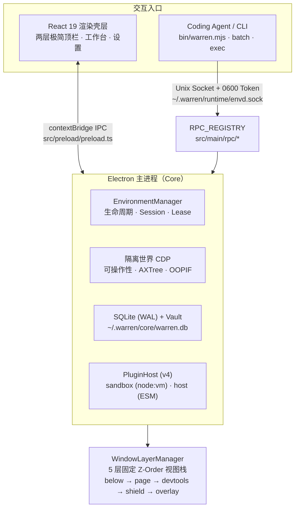

### 关键架构设计

- **两层极简桌面壳 + 全局保活页**：
  - **Row 1 顶栏（`40px`）**：侧栏折叠（`⌘B`）、当前环境徽标、`我的 | Agent` Space 切换器、标签条、单一控制权胶囊（交还控制权时保持原视角不变）、`⌘K` 命令面板入口与全局设置。
  - **Row 2 地址栏（`40px`）**：导航控制、URL 拆层高亮与一键复制、Omnibox 历史联想、插件 `statusBadge` / `popover` 槽位、缩放、居中点阵画布与等比缩放模拟视口（`390×844` / `1280×800` / `1440×900`）、常驻下载列表按钮、DevTools 与工作台检查器开关。
  - 进入全屏设置或插件 `railPage` 时保留底层侧栏与网页保活，切回零重建。
- **5 层固定原生视窗栈（[`layer-order.ts`](src/main/ui/layer-order.ts)）**：严格按照 `below → page → devtools → shield → overlay` 顺序管理子视图并统一 `8px` 圆角，确保 `OverlayHost`（`⌘K` 与弹窗）、`PopoverHost`（地址栏联想、下载面板与插件浮窗）、三层 WebGL `InputShield` 以及支持拖拽调整分栏比例的停靠式原生 `DevToolsHost`（`right` / `bottom` / `detach`）互不遮挡。
- **低检测面 CDP 与持久化遥测**：禁止长驻 `Runtime.enable` / `Network.enable`；Console 与 Network 日志全部走 Electron 原生 `console-message` 与 `webRequest` 事件并写入 WAL SQLite（`warren.db`，停机/休眠期间保留、仅 `env remove` 时清理）；CSS/XPath 解析一律跑在 `Page.createIsolatedWorld` 隔离世界内。
- **右侧随行工作台 & 6+N 设置中心**：按需展开的 `360px` 检查器抽屉包含 6 个内置面板（`events`、`snapshot`、`console`、`network`、`rules`、`storage`）与插件 `inspectorTab`；可搜索设置中心包含 6 个内置分节（`general`、`browser`、`agent`、`vault`、`plugins`、`diagnostics`）与插件 `settingsSection`，配合 4-seed 深/浅（`#181b21`）主题体系。

---

## 安全与数据边界

应用、插件与 Whistle 产生的一切数据收敛于统一根目录（`WARREN_HOME`，默认 `~/.warren`，由 [`src/main/paths.ts`](src/main/paths.ts) 与 [`bin/paths.mjs`](bin/paths.mjs) 对齐计算）：

```text
~/.warren/
├── app/                   # 桌面端壳层 Chromium userData
├── core/
│   ├── warren.db          # 唯一 SQLite WAL 数据库（环境、分组、历史、遥测、笔记、Flow、Vault）
│   ├── sessions/<env>/    # 每个 Environment 的独立持久化 Session 目录
│   └── plugins/<id>/      # 已安装插件包 + 各自隔离的 data.db
├── runtime/
│   ├── envd.sock          # 本地 Unix Socket RPC 端点
│   └── runtime.json       # 随机 0600 鉴权 token
└── whistle/               # Whistle 共用根证书与实例注册表（WHISTLE_PATH）
```

- **Vault 无明文外泄通道**：使用 Electron `safeStorage` 加密存储。`warren vault add <provider> --label=<name>` **仅从 `stdin` 读取秘密**；对外只提供 `vault.list`（仅返 `ref` 与打码 `usernameHint`）和受域名白名单约束的 `vault.fill`，同时拦截 `"toString"` 等原型字段读取。
- **环境级 CA 验签与代理认证**：`EnvironmentConfig.trustedCa` 仅在对应环境的 `Session` 内通过 `X509Certificate.verify` 精确放行该 CA 签发的叶子证书；`app.on('login')` 找不到对应 host 的 `provider=proxy` 凭据时直接拒绝认证。
- **人类专属审批策略**：控制权策略（`controlPolicy`）与环境级 `approval` 规则**只能通过桌面端 UI IPC 修改**，不向 CLI/RPC 开放写入口。

---

## 插件体系（v4）

Warren 插件是独立 npm 包，清单声明在 `package.json#warren`（仅支持 `apiVersion: "4"`），完整 TypeScript 契约见 [`packages/plugin-sdk`](./packages/plugin-sdk/index.d.ts)，详细开发规范见 [`plugins/README.md`](./plugins/README.md)。

- **可强杀双子进程运行时**：无论是 `runtime: "sandbox"`（子进程内的受限 `node:vm`，无 `require` / `fs` / `process`）还是 `runtime: "host"`（独立 Node ESM 子进程），每次 `activate` / `command` / `rpc` 均受默认 `30_000ms` 超时强杀保护（`WARREN_PLUGIN_TIMEOUT_MS` 可调）。两者均用于契约约束与防误用，并非 OS 级恶意代码沙箱——请仅安装受信任插件。
- **8 种 Fail-Closed 挂载面**：零构建 ESM 前端（`warren-plugin://<id>/app.js`）通过 `register(app)` 复用宿主 `app.ui`、`app.shell` 与 `app.host`，支持 `railPage`、`settingsSection`、`inspectorTab`、`envAction`、`envBadge`、`popover`、`statusBadge` 与 `commandBarAction`。
- **Skill 自动聚合注入**：启用插件的 `SKILL.md` 与 `references/`（单插件上限 `32KB`）会自动索引进 Warren 主 Skill。

### 三层权限模型

单一事实源位于 [`src/shared/permissions.ts`](src/shared/permissions.ts)（共 `19` 项）：

| 层级 | 权限项 | 策略说明 |
|---|---|---|
| `granted` (`6`) | `environment.read`, `browser.dom.read`, `browser.screenshot`, `ui.mount`, `storage.write`, `rpc.serve` | 安装即授予 |
| `confirm` (`8`) | `environment.write`, `browser.navigate`, `browser.input`, `vault.fill`, `network.observe`, `network.fetch`, `storage.cookie.port`, `events.subscribe` | 须人工显式批准（`warren plugin grant` 或界面授权） |
| `denied` (`5`) | `browser.evaluate`, `storage.cookie.read`, `storage.cookie.write`, `process.spawn`, `filesystem.read` | **永久禁用**，即使在清单中声明也不会生效 |

### 官方与示例插件

| 插件 | ID | 运行时 | 说明 |
|---|---|---|---|
| **Whistle 代理** | `com.warren.whistle` | `host` | 为每个环境托管独立 `whistle@2.10.15` 实例（`46` 条命令、`7` 处协同界面）：HTTPS 抓包、受控 `quickMock` / `injectFault` / `mapLocal` 意图组、脱敏重放 Diff、cURL 导出与规则诊断。 |
| **账号管理** | `com.warren.accounts` | `sandbox` | 站点智能匹配、零手写选择器自动登录填充与 RFC 6238 动态 TOTP（`16` 条命令、`5` 处界面）。**明确产品例外**：按设计在自身 `data.db` 明文存储测试账号并持续展示警示；Agent 通道绝不回传明文且强制非空域名白名单。 |
| **记忆** | `com.example.notes` | `sandbox` | 按环境或全局沉淀任务待办与上下文摘要（`9` 条命令、`5` 处界面）。 |
| **示例插件组** | `com.example.{login,cookies,hosty}` | `sandbox` / `host` | 演示 `vault.fill`、只搬运不返回 Cookie 值的 `storage.cookie.port` 受控通道以及 `host` 运行时用法。 |

```bash
# 安装并体验内置 Whistle 插件预设
warren plugin install path:plugins/whistle
warren plugin enable com.warren.whistle
warren plugin run com.warren.whistle presetPreview --input='{"storage":"<instance>","scenario":"test"}'
warren plugin run com.warren.whistle presetApply --input='{"storage":"<instance>","scenario":"test","expectedHash":"<preview-hash>"}'
```

---

## 目录结构与开发校验

```text
warren/
├── bin/                   Agent CLI 入口 (warren.mjs) 与分域子命令 (commands/*.mjs)
├── src/
│   ├── shared/            跨进程单一契约 (permissions.ts, plugin-host-api.ts, types/*.ts)
│   ├── main/              Electron 主进程 (env/, ui/, browser/, net/, plugins/, rpc/, store/, vault/)
│   ├── preload/           contextBridge 类型安全 IPC 桥
│   └── renderer/          React 19 + Vite 8 + Tailwind v4 + base-ui 桌面界面
├── packages/plugin-sdk/   @warren/plugin-sdk 类型声明与契约
├── plugins/               官方与示例插件 (whistle, account-manager, example-*)
├── skills/warren/         Warren 内置主 Skill 模板
├── tests/                 Node 单元测试 (71 文件) + Vitest/happy-dom 无头 UI 测试 (tests/ui/)
├── scripts/               本地 fixture 服务、变更筛选测试脚本与回归套件
└── docs/                  架构演进计划、产品 PRD、UI 设计规范与项目交接
```

### 日常开发与 CI 门禁

```bash
npm run check:changed             # 日常推荐：oxlint + prettier + tsc + 基于 git diff 的无头单测与 UI 测试
npm run test:ui                   # 仅跑无头 React UI 测试套件（Vitest + happy-dom）
npm run check                     # 全量无头门禁：lint、format、typecheck、全量 node:test & vitest、Vite 构建
npx tsc -p tsconfig.check.json    # 覆盖 src/、tests/ 与 @warren/plugin-sdk 的全量类型检查
```

### 文档索引

| 主题 | 文档 |
|---|---|
| 文档阅读顺序 | [`docs/README.md`](./docs/README.md) |
| 架构决策与当前状态 | [`docs/HANDOFF.md`](./docs/HANDOFF.md) |
| 产品 PRD 与 CLI 契约 | [`docs/PRD.md`](./docs/PRD.md) |
| 技术选型与否决方案说明 | [`docs/TECH-STACK-RESEARCH.md`](./docs/TECH-STACK-RESEARCH.md) |
| 设计语言与组件契约 | [`docs/ui-design-language.md`](./docs/ui-design-language.md) |
| 插件开发指南与 SDK | [`plugins/README.md`](./plugins/README.md) · [`packages/plugin-sdk/README.md`](./packages/plugin-sdk/README.md) |
| 构建、签名与公证发布 | [`docs/RELEASE.md`](./docs/RELEASE.md) |

---

## 开源协议

本项目采用 [MIT License](./LICENSE) 开源协议。
