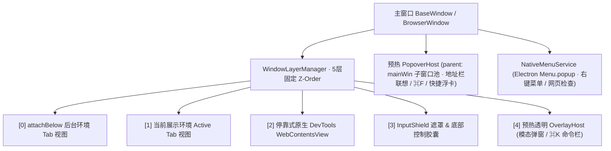
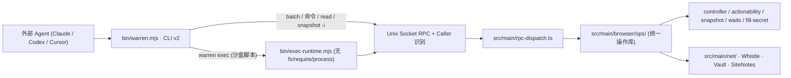

# Warren 2.0 全面重构架构总蓝图

> 状态：**架构设计已冻结，待分波实施**  
> 日期：2026-11-26  
> 关联前置文档：`AGENTS.md`、`docs/HANDOFF.md`、`docs/PRODUCT-ARCHITECTURE-2026-10-17.md`、`docs/CHROME-SHELL-PLAN.md`、`docs/ELECTRON-REALISM-PLAN.md`、`docs/PLUGIN-CAPABILITY-DESIGN.md`、`docs/FULL-REGRESSION-2026-10-15.md`

---

## 目录

- [§0 产品北极星与架构裁决](#0-产品北极星与架构裁决)
- [§1 支柱一：窗口分层、叠层根治与原生交互（Wave 1）](#1-支柱一窗口分层叠层根治与原生交互wave-1)
- [§2 支柱二：Chrome 级开发者工具与页面内建能力（Wave 1）](#2-支柱二chrome-级开发者工具与页面内建能力wave-1)
- [§3 支柱三：核心主进程解耦与插件机制 2.0（Wave 2）](#3-支柱三核心主进程解耦与插件机制-20wave-2)
- [§4 支柱四：UI/UX、渲染层状态与设置中心整体重构（Wave 3）](#4-支柱四uiux渲染层状态与设置中心整体重构wave-3)
- [§5 支柱五：Agent CLI v2 与统一操作库（Wave 4）](#5-支柱五agent-cli-v2-与统一操作库wave-4)
- [§6 数据模型增量（`warren.db`）与跨进程契约变更](#6-数据模型增量warrendb与跨进程契约变更)
- [§7 分波实施路线图与验收门禁（Wave 0–4）](#7-分波实施路线图与验收门禁wave-04)
- [§8 风险登记簿与回滚策略](#8-风险登记簿与回滚策略)

---

## 基线快照（2026-11-26 实盘盘点）

- **技术底座**：Electron `44.7.0` + React `19.3.0` + `@base-ui/react` + Tailwind v4 + TypeScript `7.0.2` + Vite + `node:sqlite`。
- **打包配置（`forge.config.cjs`）**：启用 `[FuseV1Options.RunAsNode]: false`，渲染层单入口 `main_window`（`vite.renderer.config.mjs`）。
- **代码体量与热点文件**：
  - 主进程与共享层：`src/main/environments.ts`（1837 行）、`src/main/rpc-dispatch.ts`（963 行）、`src/main/plugins/host.ts`（850 行）、`src/main/plugins/api.ts`（510 行）、`src/main/plugins/runtime.ts`（489 行）、`src/shared/types.ts`（817 行）、`src/main/browser/`（23 个文件）。
  - 渲染层：`src/renderer/app/App.tsx`（552 行）、`src/renderer/features/environments/environment-sidebar.tsx`（694 行）、`src/renderer/features/settings/settings-page.tsx`（135 行）。
  - 权限与存储：`src/shared/permissions.ts`（18 条权限：`granted` 6 / `confirm` 7 / `denied` 5，单一来源）；`src/main/db.ts`（14 张 SQLite 表，单库 `warren.db`）。
  - 外围资产：`plugins/`（6 个独立插件包）、`tests/`（46 个测试文件）。
- **基线待修瑕疵**：`docs/HANDOFF.md` 第 224–317 行存在远端快照带入的合并冲突标记残余，纳入 Wave 0 清理。

---

## §0 产品北极星与架构裁决

### 0.1 产品北极星与 Non-Goals

Warren 2.0 的定位：**具备原生 macOS 交互手感的 Agent-first 多环境隔离浏览器与研发联调工作台**。

**明确的非目标（Non-Goals）**：
1. 不做消费级日常主力浏览器（不做 iCloud 同步、跨浏览器书签迁移、流媒体 Widevine DRM 兼容）。
2. 不自建 Chrome Web Store 或内置 `chrome.*` 完整扩展宿主（避开 `electron-chrome-extensions` 的 GPL-3.0 传染与 1400+ 行兼容债）。
3. 不退回双浏览器进程栈（不另起独立 Playwright 浏览器；右侧页面与 Agent 操作始终指向同一 `WebContentsView` 实例）。

### 0.2 三项核心架构裁决

#### 裁决 1：继续基于 Electron 44 演进，不 Fork Ardia 或自编译 Chromium

通过对 `ardia-browser/ardia` 源码与构建体系的核查：
- **协议红线**：Ardia 整包分发受 **GPL-3.0** 强传染约束（源于 Helium 补丁栈与内置 uBlock Origin），对外分发派生二进制将触发整仓开源义务；其 120+ 自研 C++ 补丁叠在 Helium 之上，剥离退回纯 BSD-3 Chromium 成本极高。
- **维护成本**：Ardia 并非轻量原生壳，而是 Chromium 158 自编译框架（20 种语言、8000+ 提交、多台构建机与并发 Agent 团队维护），macOS 版仍基于带 173 KB 补丁的 `react-native-macos` 0.81 Legacy 架构，且 Linux/Windows 已转向 `chrome://` WebUI。单人维护每 4 周跟进 Chromium 大版本安全补丁不可持续。
- **真正该吸收的精华**：Ardia 的 `NSPanel` Popover 分层、Unix Socket 进程树识别与控制胶囊、`batch --bail` / `notes` / `--skill` CLI 体验，以及无权限独立插件宿主思路——这些在 Electron 44 中**全部无需自编译内核即可实现**。

#### 裁决 2：自建统一操作库，拒绝外包 `agent-browser` 与 `browser-use`

| 方案 | 核心机制 | 裁决与关键依据 |
|---|---|---|
| `browser-use/browser-use`（Python / MIT） | 自带 LLM 决策循环的 Python Agent 框架 | **排除**。引入 Python 运行时，且与外部 Agent（Claude Code / Codex / Cursor）调用工具的控制流冲突。 |
| `vercel-labs/agent-browser`（Rust / Apache-2.0） | 独立 Rust daemon，通过 `--cdp` 连浏览器调试端口 | **排除**。强制开放 `--remote-debugging-port` 会增加本地端口探测面，且完全绕开 Warren 的 Environment 寻址、双 Space 隔离、Lease 锁、后台静默 `attachBelow` 与 Vault 无明文直填；同时产生双守护进程与双 Ref 表状态分裂。 |
| **自建 Warren 统一操作库（`src/main/browser/ops/` + `bin/`）** | 兼容 `agent-browser` 省 Token 语法 + 吸收 Ardia 变化回执 + 融合 Warren 自有能力 | **采纳**。100% 复用已通过回归验证的 23 个 CDP 控制模块与隔离世界定位器，零损失保住全部安全门控与多环境能力。 |

#### 裁决 3：十大硬安全边界 100% 原样保留

本蓝图涉及的所有重构均**不得放宽或破坏**以下既有安全约束：
1. **Vault 无 reveal 通道**：对外仅保留 `vault.list`（打码提示）与 `vault.fill` / `browser.fillSecret`（直接进页面字段），明文永不回传 Agent 或渲染层；`warren vault add` 仅从 stdin 读秘密。
2. **代理认证无凭据即拒绝**：`app.on('login')` 找不到对应 `provider=proxy` 凭据直接拒绝认证，不静默放行。
3. **Cookie 宽形状权限永留 `denied`**：`storage.cookie.read` / `storage.cookie.write` 维持 `denied`；Cookie 搬运能力继续只走 `storage.cookie.port`（`confirm` 层，值不出主进程）。
4. **权限分层单一来源**：所有权限仅由 `src/shared/permissions.ts` 定义与导出，禁止在主进程或渲染层抄写第二份表。
5. **账号管理插件显式产品例外不扩散**：`com.warren.accounts` 的明文存储例外仅限自身 `data.db`，UI 持续显示警告；Agent 通道永远不回传明文，`reveal` 仅限 `caller='ui'`，`export` 需 `{"confirm":"plaintext"}`。
6. **证书放宽单口子**：`EnvironmentConfig.trustedCa` 仅作用于该环境 Session，走真实 `X509Certificate.verify` 验签，读不出 CA 不装钩子。
7. **审批策略仅界面 IPC 可写**：`app_settings`（`controlPolicy` / `pluginPolicy` / 外观与浏览器全局配置）与 `EnvironmentConfig.approval` 仅限渲染层 IPC 修改，RPC / CLI 保持只读。
8. **单数据根**：全部运行态与持久化统一归口 `WARREN_HOME`（默认 `~/.warren`），`src/main/paths.ts` 与 `bin/warren.mjs` 保持同步。
9. **渲染层 CSP 边界**：`src/renderer/index.html` 维持 `script-src 'self' warren-plugin:`，严禁增加 `unsafe-inline` / `unsafe-eval`。
10. **测试值脱敏**：凭据测试样例一律使用 `[REDACTED]`。

---

## §1 支柱一：窗口分层、叠层根治与原生交互（Wave 1）

### 1.1 现状病根

当前 `src/renderer/lib/native-view-overlay-guard.ts` 通过 `MutationObserver` 监听 `[data-open][role=menu|dialog|...]`，当检测到 DOM 浮层与 `[data-slot="stage-placeholder"]` 矩形重叠时：
1. 延迟 2 帧等待 Floating UI 定位；
2. 异步调用 `window.envApi.pageSnapshot()`（`capturePage()`）截静态帧垫底（窗口被遮挡时还会因 `UnknownVizError` 回退为直接黑屏）；
3. 调 `setViewVisible(false)` 把整个页面 `WebContentsView` 与 `InputShield` 藏起来。

**四个严重副作用**：
- 每次开菜单或弹窗均存在**多帧延迟与闪黑/跳帧风险**；
- 隐藏视图触发 Chromium 后台节流（`document.hidden` 变 `true`），正在播放的视频、CSS 动画、HMR 热更新瞬间冻住；
- `src/main/environments.ts` 将 `viewVisible === false` 判定为不可操作（`ENV_NOT_VISIBLE`），人在侧栏打开任何与舞台边界擦边的菜单，都会**误杀后台正在执行自动化任务的 Agent**；
- 所有下拉框、联想列表为了规避藏页逻辑被迫缩窄或禁止越界展开。

### 1.2 目标架构：三层原生分层 + 统一视图栈

参考 Ardia Wave 3B 的 `NSMenu` + 透明 `NSPanel` 分层设计，在 Electron 44 中通过以下四个主进程原语彻底根除藏页黑魔法——**除整页切换到设置中心或插件全屏页（`stageReplaced = true`）外，页面 `WebContentsView` 永不隐藏**。



#### 模块 1：`WindowLayerManager`（规划新增：`src/main/ui/layer-manager.ts`）

收拢目前分散在 `src/main/tabs.ts`（`addChildView(view, 0)`）和 `src/main/input-shield.ts`（`raise()`）中的 Z-Order 操作，成为操作 `mainWin.contentView` 子视图栈的**唯一权威入口**：

```ts
export type ViewSlot = 'below' | 'page' | 'devtools' | 'shield' | 'overlay';

export interface LayerManager {
  setSlot(slot: ViewSlot, view: WebContentsView | undefined, bounds?: ViewportRect): void;
  setSlotBounds(slot: ViewSlot, bounds: ViewportRect): void;
  setSlotVisible(slot: ViewSlot, visible: boolean): void;
  restack(): void;
  snapshot(): Record<ViewSlot, { attached: boolean; visible: boolean; bounds?: ViewportRect }>;
}
```

- **固定栈序 invariant**：`['below', 'page', 'devtools', 'shield', 'overlay']` 严格从底到顶排列。任意槽位插入或替换后，统一按槽序校验并重排，彻底消除「切 Tab 后遮罩被盖住」「`attachBelow` 残留引用误摘顶层视图」的隐患。
- **页面圆角**：对 `'page'` 槽位视图调用 Electron 44 原生 `view.setBorderRadius(radius)`，与渲染层 CSS token 圆角严格对齐，消除直角硬切感。

#### 模块 2：`NativeMenuService`（规划新增：`src/main/ui/native-menu.ts`）

- 侧栏环境行、分组、标签条以及网页上下文菜单，全部不再用 DOM 模拟 `ContextMenu`，统一通过 IPC `ui:popupMenu` 向主进程提交描述式菜单模板（`id` / `label` / `type` / `accelerator` / `enabled` / `checked` / `submenu`）。
- 主进程调用 `Menu.buildFromTemplate(...).popup({ window: mainWin, x, y })`，回调点击的 `itemId` 给渲染层或主进程处理器。
- **收益**：真 macOS 毛玻璃、零延迟、天然越出窗口边界、完全不遮挡或冻结网页。

#### 模块 3：`OverlayHost`（规划新增：`src/main/ui/overlay-host.ts`）

- **职责**：专门承载**需要半透明全窗遮罩阻断底层交互的模态场景**：新建/编辑环境、分组管理、插件安装授权确认框、以及全局 **⌘K / ⌘L 命令栏**。
- **实现机制**：
  - 复用 `input-shield.ts` 已验证的透明 `WebContentsView` 技术路径：启动时预热 1 个 `WebContentsView`（`setBackgroundColor('#00000000')`，`preload` 绑定轻量 `overlayApi`），加载 `index.html?surface=overlay`。
  - **为何无需鼠标穿透**：Electron 的 `WebContentsView` 不支持 `setIgnoreMouseEvents`（仅 `BrowserWindow` 支持），但模态框与命令栏打开时本就需要拦截全窗点击（点击背景遮罩即关闭），因此将 `OverlayHost` 铺满窗口且常驻在 `'overlay'` 最高槽位，**0ms 弹出、底层网页 100% 保持活跃渲染**。
  - 渲染入口 `src/renderer/main.tsx` 根据 `URLSearchParams('surface')` 分发渲染轻量化 `OverlayRoot`，绝不挂载 `App.tsx` 主树与环境轮询器；主进程维护状态同步通道（`overlay:open` / `overlay:close` / `overlay:action`）。

#### 模块 4：`PopoverHost`（规划新增：`src/main/ui/popover-host.ts`）

- **职责**：专门承载**非模态、贴锚点弹出、点击外面自动关闭、且底部网页需保持完全可见可感的浮卡**：地址栏历史联想下拉、⌘F 页内查找条、Space / 代理 / Whistle 快速切换卡、下载进度清单、插件扩展弹出卡（`popover` surface）。
- **实现机制（复刻 Ardia Wave 3B `NSPanel` 策略）**：
  - 预热 1–2 个隐藏的无边框透明子窗口：`new BrowserWindow({ parent: mainWin, show: false, frame: false, transparent: true, hasShadow: true, resizable: false, skipTaskbar: true, focusable: true, vibrancy: 'popover' })`，加载 `index.html?surface=popover`。
  - macOS 下 `parent: mainWin` 底层即 `NSWindow.addChildWindow`，天然高于所有 `WebContentsView`、自动随主窗移动且允许 `beyondWindow` 探出主窗边缘。
  - **位置与边界夹紧**：接收渲染层传入的锚点矩形 `anchorRect`（主窗 CSS 像素）+ 首选尺寸 `{ width, height }` + `placement` + `beyondWindow` 布尔值，主进程调用 `screen.getDisplayMatching(mainWin.getBounds())` 换算屏幕绝对坐标并按显示器 `workArea`（或主窗边界）夹紧后 `setBounds` + `showInactive()`（或可聚焦输入型 `show()`，如地址栏建议保持输入焦点在主窗还是切入子窗需按场景参数 `focusable` 区分——地址栏联想保持 `focusable: false` 让光标始终留在地址栏输入框；⌘F 查找条可 `focusable: true`）。
  - **自动关闭规则**：监听子窗 `blur`（`focusable: true` 时）、主窗 `blur` / `move` / `resize`、以及 `Escape` 键与底层点击事件，统一通知渲染层关闭状态。

#### 模块 5：底栏控制胶囊与 `InputShield` 升级

- 将 `src/main/input-shield.ts` 顶部居中蓝框（`Agent Space 已锁定`）改为更克制的页面四周微弱呼吸边框 + 底部居中的精简控制胶囊（类似 Ardia `CliControlPill`）：显示真实调用方（如 `Claude Code 正在操作 · 接管`），避免挡住网页顶部导航栏。

### 1.3 废除 `native-view-overlay-guard.ts` 与消除 `ENV_NOT_VISIBLE` 误杀

- **清理项**：删除 `src/renderer/lib/native-view-overlay-guard.ts` 及其在 `App.tsx` 中的挂载；移除主进程 `layout:pageSnapshot` 仅供垫底用的热路径依赖。
- **语义收窄**：`setViewVisible(false)` 以后**仅在 `stageReplaced === true`（用户切到全屏设置页或插件独立页面）时调用**。侧栏菜单、新建弹窗、命令栏、地址栏下拉打开期间，`viewVisible` 恒为 `true`，后台 Agent 操作不再因任何浮层而被误报 `ENV_NOT_VISIBLE`。

### 1.4 关键坑点与验收判据

- **地址栏联想焦点不抢走**：地址栏联想 Popover 若设 `focusable: true` 且抢走焦点，会导致用户在地址栏连续打字中断；地址栏联想专用模式须走 `focusable: false` + 主窗输入框上下键/回车事件透传。
- **验收判据**：
  1. 网页播放 60fps CSS 动画/视频或本地 HMR 页面时，打开新建环境弹窗、右键菜单、地址栏下拉、⌘F 查找条，底层网页**无停帧、无 `document.hidden` 变化、无闪烁**。
  2. 打开上述浮层的同时并发执行 `warren exec <env>` 点击操作，**0 次 `ENV_NOT_VISIBLE` 误杀**。
  3. 拖动主窗口、切换多显示器、调整窗口大小时，`PopoverHost` 坐标对齐无偏移残留。

---

## §2 支柱二：Chrome 级开发者工具与页面内建能力（Wave 1）

### 2.1 打破旧假设：实现真停靠式原生 Chrome DevTools

此前 `src/main/tabs.ts:439` 与 `docs/HANDOFF.md:1169` 认为在 `BaseWindow + WebContentsView` 下 `openDevTools({ mode: 'right' | 'bottom' })` 无法停靠。但经查证本机 `node_modules/electron/electron.d.ts:18760`：

> `contents.setDevToolsWebContents(devToolsWebContents)` —— *With the `setDevToolsWebContents` method, developers can use any `WebContents` to show the DevTools in it, such as `BrowserWindow` or `WebContentsView`.*

**规划新增 `src/main/ui/devtools-host.ts`**：
1. **三态停靠**：支持 `dock: 'right' | 'bottom' | 'detach'`（与用户偏好持久化），在环境舞台内通过分隔条调节停靠宽度/高度（260–720 px）。
2. **专用视图托管**：当环境需要展开停靠式 DevTools 时，为主进程新建一个专用的 `WebContentsView`（`devToolsView`），注册到 `WindowLayerManager` 的 `'devtools'` 槽位，执行：
   ```ts
   targetWc.setDevToolsWebContents(devToolsView.webContents);
   targetWc.openDevTools({ mode: 'detach' }); // 内容将直接渲染进 devToolsView
   ```
   然后按 `'right'` 或 `'bottom'` 动态切分舞台矩形，将左侧/上方分给 `'page'` 槽位，右侧/下方分给 `'devtools'` 槽位。
3. **生命周期严防泄漏**（`electron.d.ts:18755` 明确警告关闭 DevTools 不会自动销毁 `devToolsWebContents`）：
   - 按 `(envId, spaceId, tabId)` 绑定 DevTools 宿主生命周期；Tab 关闭、环境停止/休眠或用户关闭 DevTools 时，显式调用 `targetWc.closeDevTools()` 并销毁 `devToolsView.webContents.close()`，从 `WindowLayerManager` 移除。
   - 保持现有控制权门控：Agent 持有 `Agent Space` 锁时禁止人打开可修改 DOM/JS 的 DevTools；或自动提示「先接管控制权」。

### 2.2 六项 Chrome 原生级页面内建能力

| 能力项 | Electron 44 原生 API | 规划落点与交互细节 |
|---|---|---|
| **网页原生右键菜单 & 检查元素** | `wc.on('context-menu', (_e, params))` + `wc.inspectElement(x, y)` | 规划新增 `src/main/browser-context-menu.ts`。按点击上下文（链接/图片/选中文本/可编辑框/普通页面）动态拼装菜单：**后退/前进/刷新**、**新标签打开链接**、**复制链接/图片/图片地址**、**另存图片**、**原生剪切/复制/粘贴/全选**（调 `wc.paste()` 等原生编辑命令，顺带补齐真实粘贴）、**查看页面源码**（新开 `view-source:<url>` 标签）、**检查（Inspect）**（自动展开停靠式 DevTools 并高亮对应 DOM 节点）。 |
| **页内查找（⌘F / ⌘G / ⇧⌘G）** | `wc.findInPage(text, opts)` / `wc.on('found-in-page')` / `wc.stopFindInPage('clearSelection')` | 在 `PopoverHost` 右上角弹出极简查找浮条（输入防抖、实时显示 `3 / 18` 匹配数、上下跳转按钮、`Esc` 关闭并清理高亮）。 |
| **缩放管理（⌘+ / ⌘- / ⌘0）** | `wc.setZoomFactor(factor)` / `wc.getZoomFactor()` | 按环境 + 域名持久化到 `domain_prefs` 表；切换页面/新开标签自动套用对应缩放比例，地址栏右侧在非 100% 时显示可点击复位的小微标（如 `125%`）。 |
| **硬刷新（⇧⌘R）与状态感知** | `wc.reloadIgnoringCache()` | 加入 `browserShortcut` 与 `NavigationAction` 联合体，支持右键刷新图标选「正常刷新 / 忽略缓存硬刷新」。 |
| **左下角链接悬停预览** | `wc.on('update-target-url', (_e, url))` | 主进程经 IPC 推送当前 Tab 悬停 URL，在舞台左下角通过轻量悬浮胶囊显示（或在停靠层绘制），解决「不知链接去哪」的基础体验缺失。 |
| **视口预设、下载面板与打印/保存** | `Emulation.setDeviceMetricsOverride` / `will-download` / `wc.print()` / `wc.printToPDF()` / `wc.savePage()` | 工具栏新增「视口预设」按钮（自适应 / 1440×900 / 1280×800 / 390×844 Mobile，消除响应式断点偏差，见 `ELECTRON-REALISM-PLAN.md` §1.1）；`downloads.ts` 增加下载进度与历史列表，顶栏挂载下载图标并用 `PopoverHost` 展示（支持在 Finder 中显示）；菜单与快捷键支持 `⌘P` 打印 / 导出 PDF 与 `⌘S` 保存网页。 |

### 2.3 DevTools 与 Warren 检查器的清晰分工（不画饼边界）

- **坦诚的平台边界**：`HANDOFF.md` §6 已实测确认 Electron 不完整支持扩展注册自定义 DevTools 面板（`devtools_page` 类扩展，如 Chrome 商店版 React/Vue DevTools 独立 tab 不会出现在 DevTools 栏中，尽管页面内 content script 与 hook 正常运行）。
- **最优分工**：
  - **停靠式原版 Chrome DevTools**：负责标准单页底层调试（Elements 改样式、Sources 断点调试、Console 实时 REPL、Network 瀑布流、Application Storage、Device Mode）。
  - **Warren 联调检查器（Inspector）**：专注 **Chrome DevTools 做不到或不适合做的事**——Agent 可访问性树与元素高亮、Whistle 规则实时命中追踪、Net Mock/HAR 规则开关、环境/Agent 操作事件时间线、插件注入面板（如 Notes / 账号）。
  - 两者共享右侧/底部停靠槽位或支持一键切换，职责零重叠。

---

## §3 支柱三：核心主进程解耦与插件机制 2.0（Wave 2）

### 3.1 热点文件拆解方案

#### 1. `src/main/environments.ts`（1837 行）拆分为薄 Facade + 4 个协作者

保持外部调用方（`main.ts`、`rpc-dispatch.ts`）对 `EnvironmentManager` 的方法签名稳定（逐步收敛），内部拆入 `src/main/env/`：
- `src/main/env/session-factory.ts`：Session 创建、代理认证绑定、`trustedCa` X509 验证与 `certificate-error` 兜底、UA 伪装、解包扩展加载、`#netOps` 挂载。
- `src/main/env/lifecycle.ts`：`start` / `stop` / `hibernate` / `wake` / LRU 空闲休眠调度、`restoreRunning`、持久标签快照读写。
- `src/main/env/lease-coordinator.ts`：`acquire` / `release` / `takeover` / `renew` / `assertWritable` / `ensureOperable`（`attachBelow` + `Emulation.setFocusEmulationEnabled` 后台操作协议）与 `InputShield` 状态同步。
- `src/main/env/view-coordinator.ts`：窗口展示、`select` / `selectSpace`、`WindowLayerManager` 槽位编排、停靠式 `DevToolsHost` 与 `setViewport` 协调。
- `src/main/environments.ts`：收窄为 ~300 行的协调 Facade（对外暴露组合接口与 `onChange` 增量事件发射）。

> 工程提醒（遵循 `AGENTS.md`）：被 `tests/` 直接加载的纯逻辑子模块必须保持不 `import electron`、禁用 TS 参数属性、且内部相对导入带 `.ts` 扩展名。

#### 2. `src/main/plugins/` 模块重构

- **拆解 `host.ts`（850 行）**为三个职责单一的模块：
  - `src/main/plugins/installer.ts`：`install` / `update` / `uninstall` / `hashPluginDir` / 包完整性校验；
  - `src/main/plugins/lifecycle.ts`：`enable` / `disable` / `reload` / 状态机转换 / `activate` 与 `dispose` 超时守卫；
  - `src/main/plugins/invoker.ts`：`run` / `rpc` / `hostRead` 调用调度、上下文透传（`caller: 'ui' | 'agent'`）与调用日志记录。
- **拆解 `api.ts`（510 行）**：拆至 `src/main/plugins/api/` 目录（`index.ts` 注册器 + `environment.ts` / `browser.ts` / `vault.ts` / `storage.ts` / `net.ts` / `events.ts`），所有 Host API 方法统一通过声明式 `CapabilitySpec` 定义（自动绑定权限层校验 + 是否惰性取 lease + 参数校验 + 自动生成文档与自省目录）。

#### 3. 共享契约分域（`src/shared/`）

将 `src/shared/types.ts`（817 行）按域拆分至 `src/shared/types/`（`environment.ts` / `browser.ts` / `plugin.ts` / `ui.ts` / `rpc.ts` / `settings.ts`），并由 `src/shared/types.ts` 统一 re-export，保证既有 `@shared/types` 导入路径零破坏。

### 3.2 插件运行时 2.0：可真强杀的 `sandbox` 进程

**现状痛点**（`src/main/plugins/runtime.ts:44-50` 已坦承）：`SandboxRuntime` 运行在主进程的 `node:vm` 上下文中，`vm` 的 `timeout` 仅覆盖同步求值；一旦插件 `async run()` 内存在永不 resolve 的 Promise 或 CPU 死循环，主进程只有 `Promise.race` 放弃等待——**泄漏的异步任务仍在主进程内空转或阻塞事件循环**。

**演进目标（对标 Ardia `ArdiaPluginHost` 强进程隔离 + 兼容 Warren `forge.config.cjs` 的 `RunAsNode: false` Fuse）**：
- **统一走 `utilityProcess.fork()` 子进程边界**：
  - `runtime: 'host'`（全权插件，如 Whistle）：独立 `utilityProcess`，拥有 Node 完整能力（`fs` / `child_process`），通过 JSON-RPC 回主进程调受控 `host.*` API。
  - `runtime: 'sandbox'`（能力插件，如账号管理 / Notes）：同样运行在**独立 `utilityProcess`** 中，但在引导脚本（`SANDBOX_BOOTSTRAP`）执行插件代码前，**禁用模块加载器并运行于受限 `node:vm` 上下文**（不暴露 `require` / `process` / `fs` / `child_process` / 原生网络，仅注入 `host` JSON-RPC Proxy 与 `log`）——或者通过启动独立无权沙盒参数启动子进程。
- **直接收益**：
  1. **真正可杀的超时与取消**：主进程遇到 `PLUGIN_TIMEOUT` 或用户点击停用/重载时，直接 `child.kill()` 回收整个子进程与悬空 Promise，主进程事件循环彻底安全。
  2. **崩溃隔离与退避重启**：单个插件 OOM 或未捕获异常仅导致自身 `utilityProcess` 退出，状态标为 `crashed` 并向插件面板回传堆栈，支持指数退避自动恢复或手动重载，**绝不拖垮 Core 主进程**。
  3. **保留诚实的信任提示**：由于 Node `utilityProcess` 仍共享操作系统账号权限，UI 上继续明确标注“仅安装可信插件”，不虚假宣称 OS 级强沙箱（除非后续按需外包 `sandbox-exec` 配置文件）。

### 3.3 主进程 → 插件只读事件总线（`events.subscribe`）

弥补 `docs/PRODUCT-ARCHITECTURE-2026-10-17.md` §6.3 预留的能力缺口：
1. **权限登记**：在 `src/shared/permissions.ts` 新增 `'events.subscribe': 'confirm'`（总计 19 条权限，须用户显式授权）。
2. **订阅协议**：
   - 插件在 `activate(ctx)` 中调用 `ctx.host.events.subscribe(filter, handler)`（`filter` 支持按 `environmentId` 与事件类型白名单如 `'nav.committed' | 'lease.changed' | 'tab.created' | 'env.status' | 'net.hit'` 过滤）。
   - `sandbox` 与 `host` 均通过 `utilityProcess` 的**单向 JSON-RPC Notification** 推送只读快照事件（**仅推送脱敏元数据，严禁包含页面正文、Cookie 值、凭据明文**）。
3. **防泄漏不变量**：主进程 `EventDispatcher` 以 `pluginId` 建索引；只要插件 `disable`、`reload` 或进程崩溃退出，**自动一次性注销该 `pluginId` 下全部订阅**；同时加每插件背压队列上限（如 256 条丢旧保新），防止高频网络事件把慢插件写爆。

### 3.4 前端插件 `SurfaceRegistry` 注册表化

解决目前 `SURFACE_KINDS` 写死 4 种（`railPage` / `settingsSection` / `envAction` / `inspectorTab`）的问题（`src/renderer/lib/plugin-runtime.ts`）：
- 升级为动态注册表 `SurfaceRegistry`，新增 3 个高价值挂载点：
  1. **`popover`**：挂在顶栏工具区或环境行快捷按钮，点击在 `PopoverHost` 中展开（适合 Whistle 快捷开关、账号快捷填充面板）。
  2. **`commandBarAction`**：向全局 `⌘K` 命令栏贡献动作条目（如 Whistle 一键切换预设场景）。
  3. **`statusBadge`**：在环境行或底部状态条展示实时微标（替换旧版硬编码信号）。
- **双渲染模式收敛**：简单列表/表单型插件支持**声明式 JSON 视图基元**（无需写构建脚本与加载外部 JS bundle，宿主按 `base-ui` 原生组件渲染，零白屏风险）；复杂交互插件保留 `warren-plugin://` ESM bundle + `app.ui` + `ErrorBoundary` 兜底。

---

## §4 支柱四：UI/UX、渲染层状态与设置中心整体重构（Wave 3）

### 4.1 渲染层状态管理与增量同步重构

**现状病根**（`src/renderer/app/App.tsx` 552 行）：
- 所有状态全部堆在 `App.tsx` 顶层；主进程任何细微改动发出无载荷的 `state:changed` → `stateTick++` → 渲染层全量并发重拉 `list` + `groups` + `events` + `selected` + `plugins` + 重新校验全部插件 bundle。
- 每 `1500ms` 无条件轮询 `console` + `network` + `navState` + `netRules` + `netHits`，哪怕用户根本没打开检查器、页面也没动。

**目标架构（`src/renderer/state/` 按领域拆为 4 个轻量 store，不引入第三方重状态库，使用 React 19 `useSyncExternalStore` + 原生订阅）**：
1. `environment-store.ts`：环境列表、分组、选中态、双 Space 与 Tab 元数据；订阅主进程增量通知（`env:updated` / `env:removed` / `nav:changed`）。
2. `telemetry-store.ts`：Console / Network / NetRules / NetHits；**仅在检查器展开对应 Tab 时按事件流推送或按需拉取，检查器收起时零轮询开销**。
3. `plugin-store.ts`：已安装插件清单、Surface 注册表、Badge 与设置描述符；仅在 `plugin:changed` 通知时按需增量重载变更的插件，不再跟着环境选择状态一起重刷。
4. `navigation-store.ts`：主舞台路由（环境 / 插件独立页 / 设置中心）、命令栏状态、Popover 锚点、DevTools 停靠位与宽/高布局持久化。

### 4.2 页面交互与视觉体验重构

延续既有设计契约（4-seed 主题 token、`surface.ts` recipe、`@base-ui/react`、`components/icons.tsx` Hugeicons 单源、镜像路径 `components/ui/` 不挪动）：

1. **三段式极简工作台布局**：
   - **极窄常驻 `AppRail`**：环境工作台、全局命令栏入口（⌘K）、已激活 `railPage` 插件图标、底部设置入口。
   - **高信噪比 `EnvironmentSidebar`（`environment-sidebar.tsx` 694 行拆为分组头、环境行、右键菜单桥接 3 个子文件）**：
     - 环境行默认仅保留 3 类高价值信号：**状态圆点 + 环境名 + 出口微标（直连 / Whistle 场景名 / 代理）**，当 Agent 占锁时附带小型调用方标识（如 `Claude`）；
     - 所有次级操作（编辑配置、复制代理、扩展管理、休眠/唤醒、删除）统一走原生右键菜单（`NativeMenuService`）或行内快捷弹出 `PopoverHost` 浮卡，不堆叠多余图标。
   - **无边框主舞台（`EnvironmentStage`）**：
     - **紧凑顶栏**：标签条与地址行优化纵向像素占比，Tab 支持右键原生菜单、静音图标、拖拽重排；地址栏左侧展示当前 Space 药丸（`Person` / `Agent` 一键切换，带状态色与接管按钮），右侧收拢「视口预设 / 缩放指示 / 下载 / 扩展入口 / 检查器 / DevTools 停靠切换」。
     - **页面圆角与质感**：启用 `WebContentsView.setBorderRadius()`，消除页面四角生硬溢出现象。
2. **全局命令栏（`⌘K` / `⌘L`）**：
   - 走 `OverlayHost` 居中弹出；支持模糊搜索并一键执行：**切换环境、打开 URL、新建标签、切换 Space、切换 Whistle 场景预设、触发插件 `commandBarAction`、打开设置特定分区**。

### 4.3 设置中心（`settings-page.tsx`）整体重构

将现有仅 4 个平铺 Tab 的简陋页面升级为**左右分栏 + 顶部搜索过滤 + `max-w-2xl` 卡片表单分组**的专业设置中心（保持替代 stage 的全屏工作台视图，新增右上角「返回环境 / `Esc`」明确出口）：

| 一级分组 | 二级分区 | 核心配置项与数据落点 |
|---|---|---|
| **基础** | **1. 通用与外观** | 主题色板（4-seed 切换）、紧凑顶栏模式、页面圆角开关、工作台默认启动行为、`WARREN_HOME` 路径展示与打开目录按钮（`app_settings`） |
| **研发** | **2. 浏览器与 DevTools** | DevTools 默认停靠位置（右侧 / 底部 / 独立窗）、默认页面缩放与按域缩放清单、默认响应式视口预设、最大并发运行环境数（`maxRunning`）与空闲自动休眠阈值 |
| **自动化** | **3. Agent 与审批** | 整合现有 `AgentPanel` 与 `ApprovalPanel`：`warren` CLI PATH 检测与一键软链、Built-in Skill 多目录状态/一键安装/校验刷新、全局控制权策略（`controlPolicy`）、插件确认策略（`pluginPolicy`）、Lease 默认 TTL 与环境级例外覆盖表（仅 UI IPC 可写） |
| **安全** | **4. 凭据与安全边界** | 整合 `VaultPanel`：Keychain 加密状态、打码凭据条目管理、代理凭据快捷录入（安全掩码输入框直通后端不回显）、Warren 安全边界说明卡片 |
| **扩展** | **5. 插件管理** | 重构 `PluginsPanel`：支持按状态筛选（已启用 / 待授权 / 异常 / Host 全权）；插件卡片内嵌**三层权限矩阵开关**（`granted`/`confirm`/`denied` 清晰标注）、运行态实时资源与重启按钮、可搜索日志抽屉、以及「从本地/npm/git 安装」和「脚手架新建插件（`plugin create`）」弹窗 |
| **扩展** | **6. 已安装插件配置** | 在左侧独立组下动态挂载插件专属设置分节（如 Whistle 二进制路径与默认预设、账号管理明文安全提示与导出），不再与系统级设置项混杂 |
| **维护** | **7. 诊断与关于** | 一键环境健康自检（`doctor`：RPC socket、SQLite WAL、Whistle/w2 检查、端口冲突排查）、导出诊断脱敏报告、缓存与历史清理、版本与构建信息 |

---

## §5 支柱五：Agent CLI v2 与统一操作库（Wave 4）

### 5.1 统一操作库架构：吸取两家之长，守住 Warren 底座

在 `src/main/browser/` 内部抽出一层协议中立的操作编排层 `src/main/browser/ops/`，同时服务**CLI 单命令 / `batch` / `exec` / 插件 Host API** 四路入口：



### 5.2 兼容 `agent-browser` 的高效率语法层

| 新增 / 升级命令 | 能力说明 | 工程收益与兼容细节 |
|---|---|---|
| `warren browser snapshot <env> -i` | 紧凑交互元素树输出（`- button "提交" [ref=e12]`） | 保留 `--json` 兼容已有脚本；默认或加 `-i`（interactive-only）只保留可交互与语义节点，**实测可大幅削减 60%–80% 无关 DOM Token**；支持 `--scope` 与 `-d` 深度限制。 |
| `warren browser read <env>` | 干净正文与结构化页面阅读器 | 支持 `-s <selector>` 局部提取、`--data` 提取页面内嵌 JSON（`__NEXT_DATA__` / `application/ld+json` 等）、`--links [pattern]` 抓链、`--scroll` 自动滚动加载长列表、`--out <file>` 直接落 CSV/JSON 避免污染上下文。 |
| `warren browser find <env> <by> <spec> <action> [val]` | 语义化链式一步定位动作 | 兼容 `find role button click --name 登录`、`find label "密码" fill ...`、`find text "..." click`，无需先手写 `exec` 或拆成 snapshot + click 两步。 |
| `warren browser get / is` | 原子状态读取 | `get url\|title\|text\|html\|value\|attr\|box` 与 `is visible\|enabled\|checked`，直接回传精简标量值。 |
| `warren browser diff <env>` | 快照与视觉回归对比 | 支持 `diff snapshot`（对比上次快照变更的 refs 与文本）与 `diff screenshot`（基于已有截图哈希与像素差异），直接服务开发联调验证。 |

### 5.3 吸收 Ardia 精髓的“少回合 + 自发现 + 可观测”能力

1. **`warren batch <env> [--bail] [--json]` 与变化回执（Delta Receipt）**：
   - 支持通过 heredoc 或 JSON 数组一次下发一串命令（导航、点击、填表、按键、读取、记笔记），遇到 `--bail` 在首个失败处精准报错中止并指出第几步及原因。
   - **变化回执（Delta Receipt）**：`batch` 或高阶写动作完成短暂稳定窗口（例如 150ms 或等到导航/请求落定）后，返回体自动附带：**当前 URL/Title 是否变更、新出现的弹窗/弹框、本步触发的 XHR/Fetch 摘要（如 `POST /api/login → 200`）、以及精简增量可交互节点**——Agent 多数情况下**不用再补发一轮全量 `snapshot`**。
2. **站点记忆（`warren notes` + `snapshot` 自动注入）**：
   - 在 `warren.db` 内建 `site_notes` 表（按域名或根路径存储短笔记，替代此前孤立在 `example-notes` 插件里、观察链路看不到的状态）。
   - 提供 `warren notes get|set|append|list|rm <site> [text]`；Agent 每次调用 `snapshot` 或 `read` 命中有记录的站点时，在结果头部自动注入简短的 `# site-notes` 区块（严格限制不存储凭据明文）。
3. **全量协议自发现与防漂移门禁**：
   - `warren methods [name] [--json]`：从 `rpc-dispatch.ts` 声明的统一方法注册表实时反射生成，列出全部 RPC 方法、读写分类（`reads` / `changes`）、参数 schema 与描述，不再靠文档猜接口。
   - `warren --skill [--full]` 与 `warren skills install|status|refresh`：直接将打包进 CLI 的权威 `skills/warren/SKILL.md` 及 `references/*.md` 字节级输出；安装到 `~/.agents/skills`、`~/.claude/skills`、`~/.cursor/skills` 等目录时写入 `.warren-skill` SHA-256 校验戳以支持无损升级。
   - **防漂移单测**：在 `tests/exec-capabilities.test.ts` 基础上扩展 `tests/skill-contract.test.ts`，自动抽取 `SKILL.md` 内所有代码块和命令示例喂给真实 CLI parser 校验，任何命令名或参数漂移直接阻断 CI。
4. **调用方进程树识别与桌面端控制胶囊**：
   - CLI 启动连接本地 Unix Socket 时，读取短暂进程父链（macOS `ps -o ppid,comm` 或轻量原生调用，总耗时 < 3ms，失败静默降级为 `"warren"`），识别是否为 `Claude Code` / `Codex` / `Cursor` / `Antigravity` / `OpenCode` 等已知工具，通过 `hello` 握手带给 Core（仅作 UI 展示，不作为安全信任凭据）。
   - 桌面端在目标环境正在被操作时，于底部居中显示防闪烁胶囊（延续 3 秒防抖）：`Claude Code 正在操作 · 点击接管`。
5. **实时事件流与外部钩子**：
   - `warren events [env] [--follow]` 支持持续流式输出环境事件（NDJSON）。
   - 保留并强化 `warren exec <env>` + `emitResult` + `exec --capabilities`，与 `batch` 共用底层 RPC 与 Lease 生命周期，复杂条件循环走 `exec`，常规线性探索走 `batch`。

---

## §6 数据模型增量（`warren.db`）与跨进程契约变更

遵循 `src/main/db.ts` 既定原则：**新能力优先使用纯追加表（`CREATE TABLE IF NOT EXISTS`）与 `app_settings` 键值表**，避免破坏性改列。

### 6.1 `warren.db` 新增表草案

```sql
-- 按站点沉淀 Agent / 开发者备忘（非凭据，严禁存密码）
CREATE TABLE IF NOT EXISTS site_notes (
  site TEXT PRIMARY KEY,
  content TEXT NOT NULL,
  updated_by TEXT NOT NULL DEFAULT 'human',
  updated_at TEXT NOT NULL
);

-- 按环境 + 域名保存 Chrome 级浏览偏好（缩放比例、最近视口预设等）
CREATE TABLE IF NOT EXISTS domain_prefs (
  env_id TEXT NOT NULL,
  origin TEXT NOT NULL,
  zoom_factor REAL NOT NULL DEFAULT 1.0,
  viewport_preset TEXT,
  updated_at TEXT NOT NULL,
  PRIMARY KEY (env_id, origin)
);
```

### 6.2 `app_settings` 新增设置键（仅界面 IPC `settings:set` 可写）

- `ui.theme`：主题方案（保留既有 4-seed 契约）
- `ui.compactTopbar`：布尔，紧凑顶栏开关
- `ui.pageBorderRadius`：布尔，页面圆角开关
- `devtools.defaultDock`：`'right' | 'bottom' | 'detach'`
- `devtools.defaultViewport`：`string | null`（默认视口预设）
- `runtime.maxRunning` / `runtime.idleHibernateMinutes`：LRU 与空闲休眠阈值（优先于或兜底环境变量）
- `agent.leaseTtlMs` / `agent.showControlPill`：Lease 过期时长与底部控制胶囊开关

### 6.3 新增跨进程 IPC 与 RPC 摘要

| 通道方向 | 名称 | 职责与权限约束 |
|---|---|---|
| Renderer → Main IPC | `ui:popupMenu` | 弹出原生上下文菜单并回传选中动作 id |
| Renderer → Main IPC | `overlay:open` / `overlay:close` | 控制 `OverlayHost` 模态与全局命令栏显隐 |
| Renderer → Main IPC | `popover:open` / `popover:update` / `popover:close` | 控制 `PopoverHost` 锚点浮卡并回传关闭事件 |
| Renderer → Main IPC | `browser:devtoolsDock` / `browser:findInPage` / `browser:stopFind` / `browser:setZoom` / `browser:setViewportPreset` | Chrome 级页面调试与交互控制 |
| Main → Renderer IPC | `env:delta` / `telemetry:push` / `browser:targetUrl` / `browser:findResult` / `plugin:changed` | 增量状态推送，替换 `state:changed` 全量重刷与 1.5s 轮询 |
| Unix Socket RPC | `rpc.methods` / `browser.read` / `browser.batch` / `notes.*` | 供 CLI v2 调用，严格走既有写门控（`browser.batch` 含写步骤强制校验 Lease） |

---

## §7 分波实施路线图与验收门禁（Wave 0–4）

每波工作必须遵循：**小步提交 → 通过全套静态与单测门禁 → 涉及主进程/运行时变更必须重启应用并过真机 GUI 回归**。

### 通用强制门禁（每一波收尾必跑）

```bash
npm run lint
npm run format:check
npx tsc --noEmit
npm test
node node_modules/vite/bin/vite.js build --config vite.renderer.config.mjs
bash scripts/regress/run-all.sh   # 需应用 + fixture 8899 运行中
```

### 各波施工清单与专项验收

| 波次 | 目标主题 | 核心交付物 | 专项验收判据（必须实测） |
|---|---|---|---|
| **Wave 0** | 基线整顿与统一门禁 | ① 清理 `docs/HANDOFF.md` 第 224–317 行冲突标记并同步到现状；② 在 `package.json` 增加 `npm run check` 一键串联 5 项静态/单测/构建检查；③ 确认合入后全量测试与 152 条回归基线全绿。 | `npm run check` 0 退出；`run-all.sh` 无回归。 |
| **Wave 1** | 叠层根治 + 停靠式 DevTools + 网页原生化（支柱一 & 二） | ① `WindowLayerManager`、`NativeMenuService`、`OverlayHost`、`PopoverHost`；② 删掉 `native-view-overlay-guard.ts` 与藏页副作用；③ 停靠式 DevTools（`setDevToolsWebContents` 右/底/独立三态）；④ 网页右键「检查元素」/原生复制粘贴、⌘F 查找、按域缩放、⇧⌘R 硬刷新、悬停链接预览、视口预设、下载清单。 | ① 网页运行 60fps 动画/定时器时打开菜单/弹窗/查找条，`document.hidden` 始终 `false`；② 开浮层期间并发 `warren exec` 不再报 `ENV_NOT_VISIBLE`；③ 停靠 DevTools 切 Tab/停环境无进程或 View 泄漏（内存与 `debug.layout` 验证）。 |
| **Wave 2** | 核心解耦与插件机制 2.0（支柱三） | ① `environments.ts` 拆为 4 协作者 + 薄 Facade；② `plugins/host.ts`、`plugins/api.ts`、`shared/types.ts` 分域拆分；③ `sandbox` 迁入受限无权 `utilityProcess`（支持真超时 `kill()` 与崩溃恢复）；④ 落地 `events.subscribe`（`confirm` 层）与 `SurfaceRegistry` 注册表（增 `popover` / `commandBarAction` / `statusBadge`）。 | ① 测试插件内部注入 `await new Promise(() => {})` 验证 30s 超时后子进程真实退出且不阻塞 Core；② 触发 `reload` / `disable` 后验证 `events.subscribe` 订阅数归零；③ `example-*`、Whistle、账号插件全量回归通过。 |
| **Wave 3** | UI/UX、状态与设置中心重构（支柱四） | ① 渲染层拆出 4 个领域 store，主进程增量推送替代 `stateTick++` 与 1.5s 空转轮询；② 落地 `⌘K` 全局命令栏、紧凑顶栏、高信噪比侧栏行与底部调用方控制胶囊；③ 7 分区设置中心全面重构（含搜索过滤、`doctor` 自检与安全表单）。 | ① 空闲状态下停止轮询，检查主进程无无谓 SQLite/IPC 唤醒；② `debug.rendererEval` 校验设置中心 7 个分区导航与键盘可用性、`⌘K` 呼出与跨路由切换；③ 全部 UI 设计契约与 `icon-names.test.ts` 通过。 |
| **Wave 4** | Agent CLI v2 与统一操作库（支柱五） | ① `src/main/browser/ops/` 操作编排层；② `snapshot -i`、`browser read`、`find`/`get`/`is`/`diff`；③ `warren batch --bail` 与 Delta Receipt 变化回执；④ `site_notes` + `warren notes` 与自动注入；⑤ `warren methods`、`warren --skill`、`skills install/status/refresh` + Skill 防漂移测试；⑥ 父进程调用方识别与 `events --follow`。 | ① 单测校验 `SKILL.md` 内所有命令片段经真实 CLI parser 全通过；② 用 `batch --bail` 在本地 fixture 完成多步登录与接口抓取，验证回报含变化回执且回合数显著下降；③ `snapshot -i` 与 `read` 实测 Token 体积较全量 JSON 显著下降。 |

---

## §8 风险登记簿与回滚策略

| 风险项 | 影响面 | 预防与缓解措施 | 回滚边界 |
|---|---|---|---|
| **多显示器与 DPI 缩放下 `PopoverHost` 坐标漂移** | 地址栏下拉、⌘F 查找条贴错位置 | 统一由主进程结合 `mainWin.getBounds()` 与 `screen.getDisplayMatching()` 做物理/DIP 坐标转换，并编写纯函数坐标夹紧单测。 | 每个 Popover 组件保留受控开关，极端情况下可临时路由至 `OverlayHost` 居中/固定锚区呈现。 |
| **`setDevToolsWebContents` 在页面关闭/快速切 Tab 时崩溃或泄漏** | 内存上涨、关闭标签报对象已销毁 | 严格在 `Tab` 销毁钩子与 `EnvironmentManager.stop()` 中先 `closeDevTools()` 再销毁宿主 `WebContentsView`；每次创建前检查 `!wc.isDestroyed()`。 | 保留 `devtools.defaultDock = 'detach'` 配置项作为一键降级退路。 |
| **多渲染进程（主壳 / `OverlayHost` / `PopoverHost`）状态撕裂** | 弹窗改了环境名但侧栏未更新、快捷键冲突 | **单一数据源不变**：所有弹窗提交动作直接经 `preload` 调用主进程，不直接在多渲染进程间双向同步本地状态；主进程变更后统一向所有存活渲染表面广播增量事件。 | `OverlayHost` 与主壳复用同一份 Vite 编译产物（按 `?surface=` 分流），无多份构建维护成本。 |
| **无权 `utilityProcess` 带来额外冷启动耗时与内存** | 同时启用多个小插件时占用上升 | 按需惰性启动有后台逻辑的插件（纯声明/纯前端面板插件不拉起子进程），空闲超阈值可休眠低频插件进程。 | `PluginRuntimeAdapter` 接口层保留适配隔离，可按插件标记切换恢复策略。 |
| **CLI v2 变更破坏既有 E2E 宿主或回归脚本** | 外部集成报错 | `warren exec`、`emitResult(__CONSOLE_E2E_RESULT__)`、`browser snapshot`（加 `--json` 或兼容字段）和所有既有 CLI 子命令**保持向后兼容**，新增能力以新子命令或新 flag（如 `-i`）形式增量推出。 | 每波独立 PR/分支，凭 `backup/pre-pull-*` 与 Wave 标签随时按波次无损回退。 |
