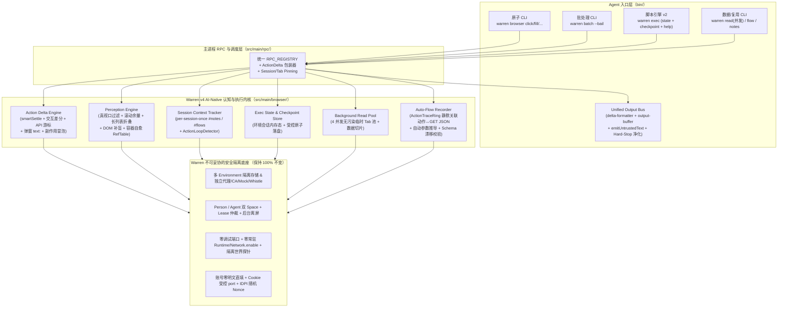

# Warren v4：AI-Native 浏览器 CLI、输出与上下文引擎全面改造计划

> **编制日期**：2026-11-27  
> **实施状态**：Wave 1–5 全部落地完成（核心引擎 + CLI + 单元测试 + 效率基准脚本均已就绪）  
> **代码基线**：Warren `main` (`bec4f1a`)  
> **对标基线**：`Ardia 0.4.0` · `agent-browser 0.27.0` · `Ego Browser 0.6.3.17` · `browser-use v1.0`（全部基于一手源码与本机实装 CLI）  
> **设计目标**：守住 Warren 独有的「多环境强隔离 + 独立代理/Mock/Whistle + 双 Space 租约 + 零端口隐身 + 凭据零明文直填」护城河，彻底重构 **AI 输入范式、输出工程（Output Engineering）与上下文闭环（Context Engineering）**，使常规多步任务 **LLM 往返回合数下降 50%–65%**、**回执 Token 占用下降 70%–85%**、**长任务断点可续且高并发无污染**。

---

## 0. 顶层设计哲学与架构总览

### 0.1 第一性原理：AI 浏览器真正的性能瓶颈

传统浏览器自动化的指标是「点击耗时多少毫秒」；而 **AI 驱动浏览器的核心成本公式**是：

```text
总耗时 & 总成本 ≈ LLM 往返回合数 (Turns) × 每轮输入上下文体积 (Context Tokens) × (1 + 重试率)
```

四大头部竞品的最新架构全部围绕压缩这一公式中的三个乘数展开：

1. **回合压缩（Turns ↓）**：通过**动作级 Delta 回执**（Ardia）、**脚本写后自动尾附 `[state]`**（browser-use v1.0）与 **动作→API 静默编译 `flow`**（Ardia / agent-browser），把“动作 → 观察 → 验证”的 3 回合压缩成 1 回合，把高频查数的 6 步 UI 操作压成 1 步只读 API 调用。
2. **信噪比最大化（Tokens ↓）**：通过**真视口感知 + 屏外余量提示**（Ego）、**同类长列表折叠**（Ardia）、**80/20 首尾截断保底弹窗**（browser-use）、**per-session-once 记忆去重注入**（Ardia / agent-browser）与**全链路输出上限落盘**，确保每进入上下文的 1 个 Token 都能直接驱动下一次决策。
3. **长任务韧性与防偏航（Retry ↓）**：通过**跨回合持久 `state` + 原子 `checkpoint`**（Ardia / browser-use）、**运行时自省 `help(api)`**（Ego）、**Hard-Stop 输出净化 + 未处理副作用冒泡**（Ego / browser-use）与 **轻型死循环探测**（browser-use），把「超时重来、盲猜参数、忽略弹出新页、原地狂点」彻底消灭在内核层。

### 0.2 Warren v4 目标架构总图



---

## 1. 五大支柱详细架构设计

---

### 支柱一：统一「动作变化引擎 & 输出治理总线」（Action Delta Engine + Unified Output Bus）

> **解决核心痛点**：
> - 当前 `warren browser click/fill/select/press/check`（[pointer-actions.ts](file:///Users/euanguo/Documents/projects/work/warren/src/main/browser/pointer-actions.ts#L68)、[browser.mjs](file:///Users/euanguo/Documents/projects/work/warren/bin/commands/browser.mjs#L104-L201)）只回 `{ x, y, url, navigation }` 或 `{ ok: true }`，无页面 Delta，AI 每步后被迫重跑 `snapshot -i`。
> - 当前 `warren batch`（[browser.mjs](file:///Users/euanguo/Documents/projects/work/warren/bin/commands/browser.mjs#L34)）非 `--json` 模式直接 `JSON.stringify(result, null, 2)` 吐出整坨双份重复 JSON，且 `batch`/`eval`/`diff`/`get`/`find`/`console`/`network`/`flow run`/`exec` 全部绕过了 `emitUntrustedText`（无 12KB 截断落盘、无 ANSI 清洗、无 `--content-boundaries`）。
> - `RefTable.tryHeal`（[locator.ts](file:///Users/euanguo/Documents/projects/work/warren/src/main/browser/locator.ts#L514)）自愈后静默吞掉未汇报；弹出新页与下载未在动作结束时主动冒泡。

#### 1.1 统一 `ActionDelta` 引擎（新建 `src/main/browser/ops/action-delta.ts`）

将原本写死在 `batch.ts` 中的前后差分抽离为通用引擎，供**所有单步写动作 RPC**与 **`browser.batch`** 共用：

```ts
// src/shared/types/browser.ts 增量契约
export interface RefHealNotice {
  ref: string;
  role: string;
  name: string;
  containerScope?: string;
}

export interface ActionDelta {
  /** 是否发生了可观测变化（URL/Title/交互节点/网络/弹窗/下载任一变化即 true）。 */
  changed: boolean;
  urlChanged: boolean;
  titleChanged: boolean;
  url: string;
  title: string;
  /** 若落到 chrome-error://，回填 Telemetry 记录的真实底层网络错误（如 ERR_CONNECTION_REFUSED）。 */
  navError?: string;
  /** 目标 ref 在重绘后自动自愈时的透明通知。 */
  healed?: RefHealNotice[];
  /** 本次动作触发的交互节点变化（新增/变更节点全部携带立即可用的稳定 @N）。 */
  nodes: {
    added: CompactDeltaItem[];
    changed: CompactDeltaItem[];
    removed: CompactDeltaItem[];
    /** 折叠后的长列表摘要，例如 "+ 48 option in combobox \"开始时间\" (@8..@55)" */
    foldedGroups?: string[];
  };
  /** 按 SQLite 自增 id 切片的非静态资源 API 摘要（高亮非 GET 与 4xx/5xx）。 */
  network: string[];
  /** 导航或打开弹窗/提示/新区域时自动提取的可读文本（含内联 [@N]），上限 800 字符。 */
  openedText?: string;
  /** 首次切到新站点时触发的一次性上下文提示。 */
  contextHints?: {
    siteNotes?: SiteNote[];
    savedFlows?: SavedFlowSummary[];
  };
  /** 强制冒泡的未处理副作用（防止 AI 遗漏新开页、下载或阻塞弹窗）。 */
  sideEffects: {
    unhandledPopups?: Array<{ tabId: string; index: number; url: string; title?: string }>;
    activeDownloads?: Array<{ downloadId: string; filename: string; state: string }>;
    openDialog?: { type: string; message: string; url: string } | null;
  };
  /** 轻型死循环告警（由 ActionLoopDetector 产生）。 */
  loopWarning?: string;
}
```

#### 1.2 触发策略与性能控制（避免引入额外延迟）

- **单步原子写命令**（`open`/`back`/`forward`/`reload`/`click`/`dblclick`/`fill`/`type`/`press`/`check`/`uncheck`/`select`/`drag`/`drop`/`upload`/`dialog`）：
  - 默认传 `includeDelta: true`（可通过 `--no-changes` 关闭；`--no-text` 仅关闭 `openedText` 抽取）。
  - **两阶段快速 Settle**：
    1. 若动作未触发导航且 `MutationObserver` 100ms 内静默、在途请求为 0，快速结束（实测额外耗时仅 ~110–150ms，换来节省 1 个完整 3–10 秒的 LLM 回合，净赚 **20x–60x 时间**）。
    2. 若触发导航或新发异步 XHR/Fetch，走 `smartSettle({ maxWaitMs: 3000, quietMs: 180 })`。
  - **零冗余 `before` 快照**：若当前 Tab 在最近 3 秒内刚拍过缓存快照（`getLastSnapshot(scopeKey)`），动作前直接复用缓存作为 `beforeSnap`，省去动作前的一次 AX 拉取，仅在动作后执行一次 `snapshotWithRefs({ interactiveOnly: true })`！
- **`warren batch`**：
  - 支持行级标志（如某一步后加 `--no-changes`），以及整体 `--step-deltas`（每步输出微差分）或默认「末尾统一 Settle + 全批次整合 Delta」。
  - `batch` 结束后自动更新 `rememberSnapshot(scopeKey, afterSnap)`，确保紧接着的 `diff snapshot` 或下一次单步动作无缝衔接。
- **`warren exec` 脚本内调用**：
  - 脚本内单次 `page.click()` 默认 `includeDelta: false`（保证循环高速运行），改为在**整段 `exec` 脚本结束时**自动附带轻量尾部状态（见支柱三）。

#### 1.3 紧凑文本回执格式（新建 `bin/delta-formatter.mjs`）

非 `--json` 模式下，告别几百行嵌套 JSON，输出超高信息密度的紧凑文本协议：

**单步点击打开确认弹窗的回执示例（~120 tokens 替代原 ~1,800 tokens + 1 额外回合）：**
```text
✓ click @14 (navigated: none)
  → healed: @14 was redrawn, matched button "删除" in dialog "订单管理"
  net: POST /api/orders/9821/precheck -> 200
  + dialog "确认删除订单"
    + button "取消" [ref=@31]
    + button "确认删除" [ref=@32]
  text: 确认删除订单 #9821？此操作不可撤销。 [取消 @31] [确认删除 @32]
```

**单步点击无任何反应时的显式反馈（立即阻断 AI 幻觉）：**
```text
✓ click @14 -> no change (url unchanged, 0 DOM delta, 0 requests)
```

**`warren batch --bail` 紧凑回执示例：**
```text
✓ batch 4/4 steps ok
  1. goto http://localhost:3000/orders -> ok
  2. fill @2 "kettle" -> ok
  3. click @5 -> ok
  4. wait --load=networkidle -> ok
delta: url changed -> http://localhost:3000/orders?q=kettle | title: 订单列表
  net: GET /api/orders?q=kettle -> 200
  + 24 row items (@18..@41, showing first 3 + last 1):
    + link "电热水壶 Pro" [ref=@18]
    + link "恒温壶 Mini" [ref=@19]
    + link "玻璃养生壶" [ref=@20]
    ... (+20 more link: @21..@40)
    + link "旅行折叠壶" [ref=@41]
[unhandled-popup] tab #2: http://localhost:3000/export-preview (use `warren tab select <env> 2`)
```

#### 1.4 统一输出安全总线 & Hard-Stop 原子净化（改造 `bin/formatters.mjs` + 新建 `bin/output-buffer.mjs`）

1. **全覆盖 `emitUntrustedText`**：
   - 将所有携带网页/DOM/网络/JS 求值结果的命令统一接入 `emitUntrustedText`：`snapshot`、`read`、`batch`、单步动作 Delta、`eval`、`diff`、`get`、`find`、`console`、`network`、`flow run`、`exec`、`vitals`/`a11y`/`react`。
   - 统一支持全局 `--max-output=<chars>`（默认 `12000`，`--full` 关闭）与 `--content-boundaries`（随机 6-byte nonce + 宽松闭合标签转义，防 GHSA 类 IDPI 逃逸），超限时自动 80/20 首尾截断并落盘 `~/.warren/tmp/` 打印完整文件路径与缩窄建议。
   - `--json` 仍返回完整无截断 JSON（仅剥离危险终端控制字符或由调用方管道消费），保持与所有外部脚本与单测 100% 兼容。
2. **Hard-Stop 原子输出净化（`bin/output-buffer.mjs`，借鉴 Ego `output-sink.ts`）**：
   - `batch` 与 `exec` 运行期将过程输出写入内存缓冲区；
   - 若遇到 **不可继续的硬中止错误码**（`CONTROL_REVOKED`、`ENV_BUSY`、`SPACE_FORBIDDEN`、`DIALOG_OPEN`），**丢弃前序可能误导 AI 的成功日志**，仅输出精炼中止说明（已执行到第 N 步、状态是否可能部分生效、唯一权威 `remedy`）；
   - 普通非硬中止错误（如 `TARGET_NOT_FOUND`）则正常刷出已执行步骤与失败点，保留调试上下文。

---

### 支柱二：下一代「视口感知 + 语义折叠 + 零噪记忆注入」感知引擎

> **解决核心痛点**：
> - [snapshot.ts:371](file:///Users/euanguo/Documents/projects/work/warren/src/main/browser/snapshot.ts#L371) 的 `scope = 'viewport'` 仅改 `limit`，未过滤视口也无屏外滚动提示。
> - [snapshot-compact.ts](file:///Users/euanguo/Documents/projects/work/warren/src/main/browser/ops/snapshot-compact.ts#L111-L227) 无同类长列表折叠、`siteNotes` 每轮重复刷屏、`saved_flows` 从未主动提示。
> - [refs.ts:216](file:///Users/euanguo/Documents/projects/work/warren/src/main/browser/refs.ts#L216) `tryHeal` 仅按 `(frameId, role, name)` 匹配，缺少容器作用域（dialog/form/row）约束。

#### 2.1 真视口过滤与空间坐标感知（改造 `snapshot.ts` + `dom-scripts.ts`）

在 `augmentFrameWithDom` 的单次隔离世界脚本中顺带返回两类数据（零额外 CDP 往返）：

```ts
export interface ViewportMetrics {
  width: number;
  height: number;
  scrollX: number;
  scrollY: number;
  scrollWidth: number;
  scrollHeight: number;
  abovePx: number;
  belowPx: number;
  scrollPercentY: number;
}
```

- 每个 DOM 关联节点计算 `inViewport`（矩形与 `[0, -120, vw, vh + 120]` 相交，或位于 `:modal` / `[aria-modal="true"]` 顶层弹窗内，或为隐藏 `input[type="file"]`）。
- **`scope: 'viewport'` 真实生效**：
  - 仅保留 `inViewport === true` 节点（及其有语义的容器祖先链）；
  - 统计被省略的屏上/屏下可交互节点数量 `omittedAbove`、`omittedBelow`；
  - 在紧凑快照头/尾自动打印显式空间提示：
    ```text
    url: https://app.example.com/settings
    title: 系统设置
    viewport: 1280x800 | scroll: 22% (above: 420px, below: 1850px)
    ... [4 interactive nodes above viewport]
    - main "设置面板"
      ...
    ... [more content below viewport: ~1850px, 19 interactive nodes omitted; scroll down or use --scope=full_page]
    ```
- **彻底根治 AI 幻觉**：AI 再也不会因为某个提交按钮在首屏下方而误以为页面缺少该按钮。

#### 2.2 同类长列表与禁用控件折叠（改造 `snapshot-compact.ts`）

在 `formatCompactSnapshot` 渲染行表前执行结构化折叠 Pass（可通过 `--no-fold` 禁用）：

1. **同类连续兄弟折叠**：在同一 `parentIndex` 下连续出现 `≥ 8` 个同 `role` 叶子节点（覆盖 `option`/`listitem`/`menuitem`/`treeitem`/`row`/`link`/`tab`/`button`）：
   - 必保项：前 3 个 + 所有携带 `selected`/`checked`/`focused`/`new` 状态的项 + 末尾 1 个；
   - 折叠行：`... (+42 more option: @12..@53; use --filter or --no-fold)`。
2. **连续禁用项折叠**：同一父节点下连续 `≥ 4` 个 `disabled` 同 `role` 节点直接折成 1 行：`... (+11 disabled button)`。
3. **长文本截断增强**：节点 `name` 超过 100 字符截断并加 `…`（保留前缀，且 `find --name` 支持按截断前缀命中）。

#### 2.3 会话级上下文追踪器与主动发现（新建 `src/main/browser/ops/context-tracker.ts`）

维护每个 `(envId, space, tabId)` 的轻量状态：

```ts
interface TabContextState {
  lastSite?: string;
  notesDeliveredHash?: string;
  flowsDeliveredHash?: string;
  webmcpDeliveredHash?: string;
}
```

- **Per-Session-Once 注入规则**：
  - 首次进入某站点（或该站点的 notes / saved_flows / webmcp 发生变化时），在 `open`、`snapshot`、`read` 或跨站跳转后的 `ActionDelta` 顶部完整注入：
    - `# site-notes`
    - `# saved-flows`（新增！通过 `store.matchSavedFlowsForUrl(url)` 匹配，列出参数签名、说明与一行可直接调用的 `warren flow run <env> <name> --param=...`）
    - `# webmcp-tools (untrusted page-declared)`
  - 同一站点后续连续 `snapshot` 不再重复打印大段文本，仅留一行零噪确认或彻底省略（直到内容更新或切站），单轮再省 300–1,000 Token！

#### 2.4 容器作用域自愈 Ref（升级 `src/main/browser/refs.ts` & `snapshot.ts`）

- `RefEntry` 增加 `containerScope?: string`（构建层次 AX 树时沿祖先栈记录最近的命名 `dialog`/`alertdialog`/`form`/`row`/`listitem`/`region`，如 `dialog:"编辑用户"`）。
- `tryHeal(ref, freshNodes)` 匹配策略升级为两级严格唯一校验：
  1. 若原 `entry.containerScope` 存在，**仅在相同 `(frameId, containerScope, role, name)` 下唯一命中 1 个节点**才允许自愈；
  2. 若无 `containerScope`，要求在 `(frameId, role, name)` 全帧唯一命中 1 个节点；
  3. 命中后返回 `RefHealNotice`，并经 `resolveTarget` → `pointer-actions`/`form-actions` → `ActionReceipt.healed` 透明汇报给 AI。

#### 2.5 轻型死循环探测器（新建 `src/main/browser/ops/loop-detector.ts`）

- 每个 `BrowserController` 维护长度 12 的环形动作指纹窗：`{ action, targetKey, urlBefore, urlAfter, changed }`；
- 判定规则：
  1. 连续 3 次 `(action, targetKey, urlBefore)` 相同且 `changed === false`；
  2. 或最近 6 步在 2 个 URL 之间无进展反复横跳 ≥ 3 次；
- 触发时不强行中断（避免误杀合法轮询），而是在 Action Delta / `exec` 尾部注入高优先级 `[loop-warning]`，给出具体替代排障建议（检查遮挡 / 滚动 / 切 `screenshot --annotate` / 用 `eval` 检查状态）。

---

### 支柱三：新一代「持久态 + 自省 + 抗超时」脚本引擎（Warren Exec v2）

> **解决核心痛点**：
> - [exec-runtime.mjs](file:///Users/euanguo/Documents/projects/work/warren/bin/exec-runtime.mjs#L10) 为一次性无状态 VM，长循环一旦超时成果清零；
> - `exec --capabilities` 只给方法名数组，无签名/参数/示例；
> - `exec` 结束时不自动提醒未处理的弹窗/下载，也不在出错时自动附带当前页诊断快照；
> - 缺少 `--out` 零重述大数据落盘。

#### 3.1 严格守住沙箱边界的跨调用持久 `state` & 原子 `checkpoint`

> **安全不变量**：`warren exec` VM 仍**绝不暴露** `fs`、`require`、`import()`、`process`、`child_process` 或原始网络模块。持久化完全经由主进程受控 RPC 代理。

1. **主进程会话态存储（新建 `src/main/env/exec-state.ts` + RPC `exec.state.*`）**：
   - 按 `(envId, sessionKey = 'default')` 在主进程维护 JSON 内存态（大小上限 2MB，键数上限 1000），写入前过脱敏/敏感词守卫（拒绝明文凭据，对齐 `assertNoteSafe`）；
   - `env.stop` / `env.remove` 自动清理，提供 `warren exec <env> --reset-state` 手动清空。
   - **生命周期同步**：
     - `warren exec <env>` 启动时通过 `exec.state.get` 拉取初始 `state` 注入 VM 全局；
     - 脚本运行期间如调用 `await checkpoint(name, value)` 或在 `finally` 阶段（**即使脚本超时或中途抛错！**），自动把可 JSON 序列化的 `state` 快照同步回主进程 `exec.state.set`，保障断点续跑！
2. **原子 `checkpoint(name, value)`（受控路径落盘）**：
   - 新增 RPC `exec.checkpoint`（或 CLI 侧宿主回调，严格限定在 `$WARREN_HOME/checkpoints/<safeEnv>/<safeName>.json`，禁止任何路径穿越与绝对路径逃逸）；
   - 写 `.tmp` + `rename` 保证原子性，避免中途被杀留下截断 JSON；写入前自动跑敏感值脱敏；
   - 返回 `{ path, bytes, items }`，供 AI 下一轮直接读取或给用户交付。
3. **零重述交付 `--out=<path>`**：
   - `warren exec <env> --out=/abs/path/rows.json`（或 `.jsonl` / `.csv`）：当脚本 `return` 或 `emitResult` 大数组/大对象时，完整数据直接写盘，stdout 仅输出紧凑元信息（路径、条数、字段名列表、前 2 条样本），节省数万输出 Token。

#### 3.2 单一真相源 API Schema & 运行时自省 `help()`（新建 `bin/exec-api-schema.mjs`）

- 把 `page`、`locator`、`mouse`、`keyboard` 与新增全局能力（`state`, `checkpoint`, `help`, `sleep`, `readAll`）的签名、参数类型、选项说明、返回值与 1 行用法收敛到唯一 Schema 文件 `bin/exec-api-schema.mjs`；
- **三处联动消费**：
  1. VM 内全局 `help(topic?)`：`help()` 打印分类速查表，`help("page.fill")` / `help("locator")` / `help("state")` 打印精确签名、选项默认值、返回值与示例；
  2. `warren exec --capabilities --detailed`：命令行直接查完整签名（保留无 `--detailed` 时的原有 JSON 结构兼容既有单测）；
  3. **`guardApi` 智能纠错（升级 `bin/page-contract.mjs`）**：AI 误调不存在的方法（如 `page.waitForNavigation()`、`locator.nth(0)`、`page.getByTestId(...)`）时，计算最接近的合法 API，抛出：
     `UNSUPPORTED_PAGE_API: page.waitForNavigation 不存在。你是想用 page.waitForURL() / page.waitForLoadState() 吗？在脚本内调 help("page.waitForURL") 查看签名。`

#### 3.3 写后自动尾附状态 + 精确源码行号报错（升级 `bin/commands/system.mjs`）

- **自动尾附状态（借鉴 `browser-use` `worker.py:1295` + `Ego` `output-sink.ts`）**：
  - `createPageApi` 跟踪 `didMutate` 与 `observedSinceLastMutation`；
  - 脚本正常结束时：
    - 始终检查未处理副作用（`browser.events` + `browser.info`），如有未接管的弹出 Tab / 进行中下载 / 活跃 Dialog，末尾自动附加 `[unhandled-popup]` / `[download]` / `[dialog]` 提示；
    - 若 `didMutate && !observedSinceLastMutation`（且未传 `--no-tail-state`），自动尾附极简当前页状态（`url`、`title`、视口进度、最近新增/关键交互节点摘要，上限 2KB），省掉 AI 专门再跑一轮观察！
  - 脚本抛错或超时时：
    - 用 `new vm.Script(wrapped, { filename: 'warren-exec.js', lineOffset: -1 })` 捕获编译期与运行期精确行号，打印出错源码上下 2 行定位箭头；
    - 同步保存已修改的 `state`，并自动附带当前页 `info` + 错误 `remedy`。

---

### 支柱四：后台并发读取池 & 静默动作录制 Flow v2

> **解决核心痛点**：
> - [browser.mjs:664-672](file:///Users/euanguo/Documents/projects/work/warren/bin/commands/browser.mjs#L664-L672) 的多 URL `read` 在当前 Tab 串行 `navigate` + `read`，既慢 4x 又毁现场；`--links` 只列链接不抓正文；`--data` 吐全量原始 JSON 不支持切片。
> - [flow.ts:137](file:///Users/euanguo/Documents/projects/work/warren/src/main/browser/ops/flow.ts#L137) 与 [data.mjs:68](file:///Users/euanguo/Documents/projects/work/warren/bin/commands/data.mjs#L68) 要求 AI 手写 URL 模板，未将交互动作与触发的一方 GET JSON 关联录制。

#### 4.1 后台 4 并发无污染阅读池（新建 `src/main/browser/ops/batch-reader.ts`）

- **核心机制**：
  - 在目标 Environment 的隔离 `Electron.Session` 下，创建轻量、离屏、不挂载到主窗层栈（不抢焦点、不污染 Agent/Person 任何可见 Tab 列表）的临时 `WebContents` worker 池（默认并发 `4`，上限 `6`，单页超时 `20s`）；
  - 复用该环境完整身份（隔离 Cookie、独立代理、自定义 `trustedCa`、`net rules`），页面加载并等 `smartSettle` 后在隔离世界运行 `READ_EXTRACTION_FN` 抽取正文，完成即 `destroy()` 释放渲染进程内存。
- **全面增强的 `warren browser read` 能力**：
  - `warren browser read <env> <url1> <url2> ... [--concurrency=4] [-s sel] [--out=file.json|csv]`（也支持 `--stdin` 每行一个 URL，最多 100 页）；
  - `warren browser read <env> --links=<pattern> [--limit=20] [-s sel] [--list] [--out=file]`：
    - 默认并发抓取当前页所有匹配 URL 的目标页正文（相对路径自动基于当前页解析）；
    - 加 `--list` 时仅打印匹配链接列表（保留快速轻量浏览）；
  - **单页阅读升级（`src/main/browser/ops/reader.ts`）**：
    - `<table>` 与 `[role=grid]` 规范化输出为 `cell1 | cell2 | cell3` 行，虚拟滚动表检测 `aria-rowcount > renderedRows` 时自动标注 `[grid: showing 25 of 1,420 rows; use --scroll to collect more]`；
    - `--data` 增强为结构化探索 + 切片：不带参数时列出页面所有内嵌 JSON 块（`__NEXT_DATA__` / `JSON-LD` / `application/json` / 顶层状态块）的摘要（块 ID、主数组路径、条数、顶层字段名），带 `--block=<id>` / `--fields=a,b.c` / `--where=k=v` / `--limit=N` 时直接精准返回裁剪后的数组！
    - 每页独立输出预算（默认 6,000 字符/页，多页总上限 36,000 字符，超限整份落盘 `~/.warren/tmp/`）。
  - 同步在 `warren exec` 中暴露 `await page.readAll(urls | { links, selector, limit, concurrency })`。

#### 4.2 静默动作关联录制 & 自动参数化 Flow v2（新建 `src/main/browser/ops/action-trace.ts`，升级 `flow.ts`）

- **零额外检测面的静默关联录制（`ActionTraceRing`）**：
  - 每个 Environment 在主进程内存中维护最近 200 步动作账本：
    ```ts
    export interface RecordedActionStep {
      stepId: number;          // s1, s2, ...
      at: string;
      action: 'open' | 'click' | 'fill' | 'select' | 'press';
      pageUrl: string;
      targetLabel?: string;    // 控件名（如 "搜索框"），用于推导参数名
      /** 仅记录非密码、非敏感输入值；password/isSecret 恒为 undefined。 */
      inputValue?: string;
      netIdBefore: number;
      netIdAfter: number;
    }
    ```
  - 当 AI 调 `warren flow steps <env>` 时，结合 `Telemetry` 中每个步骤窗口 `[netIdBefore, netIdAfter]` 内触发的**一方 GET 200 XHR/Fetch 请求**，输出直观的因果对照表：
    ```text
    s1  open   https://shop.example.com/search
    s2  fill   textbox "关键词" = "kettle"
    s3  click  button "搜索"
          s3r1  GET /api/v1/search?q=kettle&sort=sales  200  json  [matched input "kettle" -> param: q]
    ```
- **一键编译 `warren flow save <env> <name>`**：
  - 保留原有手写 `<urlTemplate>` 用法向后兼容；
  - 新增**零手写自动录制保存**：`warren flow save <env> <name> [--output=s3r1] [--param=q=kettle] [--desc="搜索商品"]`：
    1. 自动选中步骤窗口中命中用户输入参数（或主数据量最大）的只读 GET 请求；
    2. 自动把匹配的 query 值替换为 `{{paramName}}`，非参数值仅保留短词/数字，自动拒绝或剥离任何敏感参数（`token`/`sig`/`auth`/`key` 等，严格延续 `sanitizeFlowSpec` 安全防线）；
    3. 自动在当前页对选中 GET 请求采样一次（或解析返回体结构），自动推导 `extractPath`（主数组路径，如 `data.items`）、`sampleFields`（合法字段清单，供运行期校验未知 `--fields` 与 `schemaDrift`）和 `startUrl`（运行 Flow 时需保证同源的起始页）；
    4. 存入 `saved_flows` 表，并立即触发 `SessionContextTracker` 下次访问该站时自动提示！
- **执行与错误分级升级（`executeSavedFlow`）**：
  - `flow run` 若当前 Tab 不在 `startUrl` 同源下，自动在后台临时同源 Tab 发起 `fetch`（不切走当前 Tab，且复用隔离环境登录态）；
  - 精确分类失败错误码与 `remedy`：`FLOW_AUTH_EXPIRED`（401/403 或重定向到登录页）、`FLOW_RATE_LIMITED`（429）、`FLOW_SCHEMA_DRIFT`（主数组消失或字段缺失）、`FLOW_UNKNOWN_FIELD`（`--fields` 填错时直接列出真实可用字段名）；
  - `--where` 升级为默认大小写不敏感子串匹配（支持 `field==exact` 精确匹配）。

---

### 支柱五：现代复杂控件智能化、多 Agent 防踩踏与站点知识协同

#### 5.1 表单与复杂控件“一步到位”（升级 `src/main/browser/form-actions.ts`）

1. **DataGrid / 表格单元格智能 `fill`**：
   - `resolveFillControl` 若发现目标命中 `[role="gridcell"]`、`[role="cell"]` 或无现成内部 `<input>` 的 `<td>`：
     - 读取编辑前单元格文本 `prevCellText`；
     - 自动双击单元格（若 250ms 内未出现焦点编辑器则补按 `Enter`），等待编辑器就绪（≤ 1s）；
     - 若弹出的是 `<select>` / `combobox` / `input`，自动填入或选值并按 `Enter` 提交；
     - 检测编辑器是否关闭：若成功关闭则回读 `nextCellText` 并在回执中报告 `~ gridcell "...": 250 (was 150)`；若网格因校验拒绝保持编辑器打开，自动按 `Escape` 退出并抓取单元格附近的 `alert`/`aria-errormessage` 文案报错。
2. **多值 Chip / Typeahead `select`**：
   - `warren browser select <env> <target> <val1> [val2 ...]` 支持多值参数传入；
   - 对 ARIA `combobox` / chip input，逐值键入→等待建议列表稳定（≤ 1.2s）→按“精确文本 > 行内邮箱/标识匹配 > 唯一子串匹配”点击；
   - 出现 0 匹配或 ≥ 2 歧义匹配时绝不盲点，中止并返回 `availableOptions` 列表。
3. **联动控件 Disabled 短宽限（1.5s）**：
   - 对 `click`/`fill`/`select`/`check` 在 `actionability.ts` 中，若目标当前处于 `disabled` 状态，给予最多 `1500ms` 轮询宽限（此前可能因异步联动尚未解锁直接失败），让「选省 → 选市 → 提交」能稳定放进同一条 `batch`！

#### 5.2 多 Agent 并发防踩踏：Tab Pinning 与归属账本（升级 `src/main/tabs.ts` & `src/main/rpc/`）

1. **Tab 归属与单调短号**：
   - `Tab` 元数据增加 `openedBy: 'human' | 'agent' | 'popup'` 与跨重排稳定的短号 `t1, t2, ...`（不因关闭前面 Tab 而跳号导致并发 Agent 切错页，同时保留 `1-based index` 向后兼容）；
   - `tab close --agent-only` 仅关闭 Agent 自建的标签页，保护人工打开的页面。
2. **会话 Tab 绑定与 `--pin-tab`（借鉴 `agent-browser/tab_binding.rs`）**：
   - CLI 新增 `--session=<name>`（或 `WARREN_SESSION`）与 `--pin-tab`：把会话与目标 `tabId` 绑定；
   - 若绑定的 Tab 被意外关闭或崩溃，启用 `--pin-tab` 时精准返回 `TAB_GONE`（附带脱敏后的上次 URL 与 `remedy`），绝不静默降级去篡改另一个并发 Agent 的活动 Tab！

#### 5.3 站点级知识层演进（统一 `Site Knowledge` 视图）

- 将 `site_notes` + `saved_flows` + 未来插件声明的站点工具统一收敛到 `store.matchSiteKnowledgeForUrl(url)`：
  - 新增 `warren notes summary <env>` 一键查看当前站点已沉淀的所有知识（笔记 + 可用 Flow + WebMCP 工具）；
  - 在 `skills/warren/SKILL.md` 中更新最佳工作流范式：优先使用“带 Delta 的原子动作 / `batch` → 发现 `# saved-flows` 一步直调 → 复杂循环用 `exec` + `state`/`checkpoint` → 批量抓页用并发 `read`”。

---

## 2. 安全边界核查矩阵（零妥协清单）

| Warren 硬约束（`AGENTS.md`） | v4 改造涉及模块 | 守卫设计与验证方式 |
|---|---|---|
| 不开放 `--remote-debugging-port` | 全部 | 100% 走内部 `Electron.Debugger` + Unix Socket RPC，零监听 TCP 端口 |
| 不常开 `Runtime.enable` / `Network.enable` | ActionDelta / Auto-Flow / 并发 Read | 网络增量走 Electron `session.webRequest`；页内视口/文本/DOM 补盲一律跑 `Page.createIsolatedWorld` |
| 密码与凭据永不明文回显/落库 | ActionDelta / Exec `state` / `checkpoint` / Flow | 密码框值强制定宽 `"••••••••"`；`ActionTraceRing` 对 `password`/`isSecret` 禁记输入值；`state`/`checkpoint`/`flow` 全量过敏感词与认证头剥离守卫 |
| Cookie 宽权限永留 `denied` | 后台并发 `read` / `flow run` | 同源 `fetch` 与临时后台 Tab 仅在主进程隔离 `Session` 内复用登录态，绝不向 Agent 返回 Cookie 值 |
| 严禁操作 `Person Space` / 抢占前台 | 并发 `read` 池 / ActionDelta / Tab Pinning | 临时读页 WebContents 不挂主窗图层栈、不调 `focusWindow`；`--space=person` 门控保持原样 |
| `exec` 无 `fs`/`require`/`process` 越权 | Exec v2 (`state` / `checkpoint` / `help`) | VM 仍只注入纯函数代理；`checkpoint` 路径锁定在 `$WARREN_HOME/checkpoints/<env>/` 并强校验防路径穿越 |
| 网页内容 IDPI 与终端注入防护 | Unified Output Bus | 全部观测/Delta/批处理/脚本输出统一走 `stripTerminalEscapes` + `--max-output` + 随机 nonce `--content-boundaries` |
| Node ESM 无头单测规范 | 所有新增 `src/main/browser/ops/*.ts` | 零 Electron 运行时 import、显式 `.ts` 扩展名、无 TS 参数属性，确保 `node --test` 全绿 |

---

## 3. 分波次垂直切片施工计划（Wave 1 → Wave 5）

每一波都是**端到端可编译、可单测、可实机验证**的独立交付单元，按 AI 提效 ROI 从高到低排布：

### Wave 1（P0 · 约 3–4 天）：Action Delta 引擎 + 紧凑回执 + 全命令输出治理 + Hard-Stop 净化
- **核心收益**：典型任务 LLM 回合数立即下降 **50%–65%**，单次 Batch 回执 Token 下降 **70%–85%**，补齐所有命令的输出截断与 IDPI 安全防护。
- **新建文件**：
  - `src/main/browser/ops/action-delta.ts`（`withActionDelta`、快速两阶段 Settle、交互差分、API 增量过滤、新开语义区域 `openedText` 抽取、副作用冒泡）
  - `bin/delta-formatter.mjs`（单步动作与 `batch` 的极简 AI 可读文本渲染器）
  - `bin/output-buffer.mjs`（原子输出缓冲 + Hard-Stop 净化）
- **核心改造文件**：
  - [src/shared/types/browser.ts](file:///Users/euanguo/Documents/projects/work/warren/src/shared/types/browser.ts)（新增 `ActionDelta`、`RefHealNotice`、`ActionReceipt` 增补 `healed`/`downloads`/`delta`）
  - [src/main/browser/pending.ts](file:///Users/euanguo/Documents/projects/work/warren/src/main/browser/pending.ts)（`receiptSince` 与 `peekUnhandled` 增补活跃 `downloads` 与未消费 `popups`）
  - [src/main/browser/ops/batch.ts](file:///Users/euanguo/Documents/projects/work/warren/src/main/browser/ops/batch.ts)（切换复用 `action-delta.ts`，支持行内 `--no-changes`/`--no-text`）
  - [src/main/rpc/browser.ts](file:///Users/euanguo/Documents/projects/work/warren/src/main/rpc/browser.ts)（为所有写动作端点接入可选 `includeDelta` 包装，默认 CLI 开启）
  - [bin/commands/browser.mjs](file:///Users/euanguo/Documents/projects/work/warren/bin/commands/browser.mjs) & [bin/formatters.mjs](file:///Users/euanguo/Documents/projects/work/warren/bin/formatters.mjs)（`batch`、单步动作改走 `delta-formatter`，全观测命令接入 `emitUntrustedText`）
- **验收标准**：
  - 新增 `tests/action-delta.test.ts`、`tests/delta-formatter.test.ts`、`tests/output-buffer.test.ts`；
  - 实测 `warren browser click <env> @N` 在弹窗场景下 1 步返回新弹窗按钮 `@M` + 弹窗文案 + POST 状态码；无变化时输出 `no change`；`warren batch` 输出体积较当前下降 ≥ 65%；`CONTROL_REVOKED` 触发 Hard-Stop 净化。

---

### Wave 2（P0 · 约 2.5–3 天）：真视口感知 + 同类长列表折叠 + Context Tracker（Notes 去重 + Flows 自动提示）+ 循环探测 + 容器自愈 Ref
- **核心收益**：消除屏外幻觉与长列表撑爆，打通 `saved_flows` 主动发现闭环，掐断原地盲试死循环。
- **新建文件**：
  - `src/main/browser/ops/context-tracker.ts`（per-session-once 站点上下文去重与变更感知）
  - `src/main/browser/ops/loop-detector.ts`（滑动窗口无进展/往复循环探测）
- **核心改造文件**：
  - [src/main/browser/snapshot.ts](file:///Users/euanguo/Documents/projects/work/warren/src/main/browser/snapshot.ts) & [src/main/browser/dom-scripts.ts](file:///Users/euanguo/Documents/projects/work/warren/src/main/browser/dom-scripts.ts)（隔离世界采集 `ViewportMetrics` 与 `inViewport`，让 `scope: 'viewport'` 真正按视口过滤并统计上下屏外节点数）
  - [src/main/browser/ops/snapshot-compact.ts](file:///Users/euanguo/Documents/projects/work/warren/src/main/browser/ops/snapshot-compact.ts)（实现视口进度头尾提示、同类长列表折叠、`disabled` 折叠、`# saved-flows` 注入与 `--no-fold` 开关）
  - [src/main/browser/refs.ts](file:///Users/euanguo/Documents/projects/work/warren/src/main/browser/refs.ts) & [src/main/browser/locator.ts](file:///Users/euanguo/Documents/projects/work/warren/src/main/browser/locator.ts)（`containerScope` 级唯一自愈，透传 `RefHealNotice`）
  - [src/main/store/memory.ts](file:///Users/euanguo/Documents/projects/work/warren/src/main/store/memory.ts)（新增 `matchSavedFlowsForUrl(url)` 与 `matchSiteKnowledgeForUrl(url)`）
- **验收标准**：
  - 新增 `tests/snapshot-viewport-fold.test.ts`、`tests/context-tracker.test.ts`、`tests/loop-detector.test.ts`；
  - 含 80 个 `<option>` 与 30 行表格的 fixture 页面，紧凑快照节点行数压缩 ≥ 70%，底部弹窗与屏外余量提示准确呈现；连续 3 次无效点击触发 `[loop-warning]`；重复拍同站快照不再重复打印 `# site-notes`。

---

### Wave 3（P1 · 约 3 天）：Warren Exec v2（持久 `state` + 原子 `checkpoint` + `--out` + 运行时 `help()` + 自动尾附状态）
- **核心收益**：长任务超时不断点丢失，零重述交付大数据，脚本开发首试成功率显著提高。
- **新建文件**：
  - `bin/exec-api-schema.mjs`（单一真相源的 `exec` 全局与 `page`/`locator`/`mouse`/`keyboard` 完整签名 Schema）
  - `src/main/env/exec-state.ts`（环境会话级内存 `state` 管理 + 大小上限 + 敏感词守卫）
- **核心改造文件**：
  - [src/main/rpc/system.ts](file:///Users/euanguo/Documents/projects/work/warren/src/main/rpc/system.ts) 或新建 `src/main/rpc/exec.ts`（注册 `exec.state.get/set/clear`）
  - [bin/exec-runtime.mjs](file:///Users/euanguo/Documents/projects/work/warren/bin/exec-runtime.mjs)（注入 `state`/`checkpoint`/`help`/`sleep`/`readAll`，追踪 `didMutate` 与 `observedSinceLastMutation`）
  - [bin/page-contract.mjs](file:///Users/euanguo/Documents/projects/work/warren/bin/page-contract.mjs)（`UNSUPPORTED_PAGE_API` 增加模糊匹配建议与 `help()` 指引）
  - [bin/commands/system.mjs](file:///Users/euanguo/Documents/projects/work/warren/bin/commands/system.mjs)（支持 `--out=<file>`、`--reset-state`、`--no-tail-state`、`--capabilities --detailed`、精确源码行号报错、写后自动尾附轻状态与未处理副作用、超时仍持久化 `state`）
- **验收标准**：
  - 新增 `tests/exec-v2.test.ts`，校验超时断点续跑、`checkpoint` 原子写与路径穿越拦截、`help("page.fill")` 与 `exec-runtime.mjs` 100% 同步防漂移、写后自动尾附状态。

---

### Wave 4（P1 · 约 3–4 天）：后台 4 并发无污染 `read` 池 + 静默动作关联录制 `Flow v2`
- **核心收益**：多页抓取提速 **3–4x** 且零污染当前 Tab；高频只读查数从手写模板进化到自动编译，后续查数降至 **1 步**。
- **新建文件**：
  - `src/main/browser/ops/batch-reader.ts`（基于环境隔离 `Session` 的 4 并发临时后台 `WebContents` 池，读完自动释放）
  - `src/main/browser/ops/action-trace.ts`（200 步 `ActionTraceRing`，动作↔一方 GET JSON 因果关联与自动参数推导）
- **核心改造文件**：
  - [src/main/browser/ops/reader.ts](file:///Users/euanguo/Documents/projects/work/warren/src/main/browser/ops/reader.ts)（表格/虚拟滚动网格格式化、`--data` 摘要与 `--block`/`--fields`/`--where`/`--limit` 切片）
  - [src/main/browser/ops/flow.ts](file:///Users/euanguo/Documents/projects/work/warren/src/main/browser/ops/flow.ts)（升级 `extractFlowCandidates` 支持关联动作推导参数与采样主列表结构，`flow run` 支持后台同源 `fetch` 与细分错误码/可用字段回传）
  - [bin/commands/browser.mjs](file:///Users/euanguo/Documents/projects/work/warren/bin/commands/browser.mjs) & [bin/commands/data.mjs](file:///Users/euanguo/Documents/projects/work/warren/bin/commands/data.mjs)（对接并发 `read <urls>` / `read --links` / `--stdin` 与免手写 `flow save`）
- **验收标准**：
  - 新增 `tests/batch-reader.test.ts`、`tests/action-trace-flow.test.ts`；
  - 实测抓 8 个本地 fixture 链接：当前 Tab URL 纹丝不动、耗时比串行降低 ≥ 65%、结束后无残留渲染进程；
  - 实测在登录态搜索页填词点击 → `flow steps` 识别参数 `q` → `flow save search` → 新开页 `snapshot` 顶部自动提示 `search(q)` → `flow run` 一步取数。

---

### Wave 5（P2 · 约 2.5–3 天）：复杂控件智能化 + Tab Pinning 协同 + 量化 Efficiency Benchmark + Skill 全量同步
- **核心收益**：攻克企业后台 DataGrid/Chip/联动表单长尾顽疾，支撑多并发 Agent 零踩踏，并用实测数字验证全部收益。
- **核心改造文件**：
  - [src/main/browser/form-actions.ts](file:///Users/euanguo/Documents/projects/work/warren/src/main/browser/form-actions.ts) & [src/main/browser/actionability.ts](file:///Users/euanguo/Documents/projects/work/warren/src/main/browser/actionability.ts)（DataGrid cell 自动编辑回读、多值 chip `select`、disabled 1.5s 短宽限）
  - [src/main/tabs.ts](file:///Users/euanguo/Documents/projects/work/warren/src/main/tabs.ts) & [src/main/rpc/env.ts](file:///Users/euanguo/Documents/projects/work/warren/src/main/rpc/env.ts)（`openedBy` 归属标记、单调短号 `tN`、`--session` + `--pin-tab` 与 `TAB_GONE` 错误）
  - [skills/warren/SKILL.md](file:///Users/euanguo/Documents/projects/work/warren/skills/warren/SKILL.md) & [bin/commands.mjs](file:///Users/euanguo/Documents/projects/work/warren/bin/commands.mjs)（同步全部新能力、精炼推荐工作流）
- **新建评测基准**：
  - `scripts/verify/agent-efficiency-bench.mjs`：覆盖 5 类真实任务（多步联动表单+确认弹窗、80 项长下拉+虚拟列表查找、10 页并发采集、长循环超时断点续跑、重复只读查询 Flow 复用），自动统计并输出改造前后对比报告（**动作步数、总返回字符/Token 数、总耗时、首试成功率**）。

---

## 4. 全量门禁与向后兼容契约

1. **零破坏兼容**：
   - `--json` 模式保留已有核心字段，仅做**加法扩展**（新增 `delta`、`healed`、`viewport` 等可选字段）；
   - `warren exec` 保留 `emitResult`、原有 `page.*` 签名与禁用 Playwright 提示测试，所有既有 `tests/*.test.ts` 与 `tests/ui/*.test.tsx` 保持 100% 绿灯。
2. **每波必跑校验门禁**：
   - 日常波次内：`npm run check:changed`；
   - 每波收尾：`npm run check`（`oxlint` + `prettier` + `tsc --noEmit` + 全量无头单测 & UI 测试 + Vite 构建）；
   - Wave 1、Wave 4、Wave 5 完成后执行 Electron 实机定向验证（按 `AGENTS.md` 清理 `:5173` 后启动 + `debug.layout` 探针 + `agent-efficiency-bench.mjs` 实测）。

---

## 5. 已锁定的 3 个核心默认行为决策（用户拍板）

以下 3 处默认行为策略已由用户最终锁定，作为 Wave 1–Wave 5 的权威设计契约：

1. **单步原子写命令（`warren browser click/fill/select/...`）的 Action Delta 策略**：**默认开启，配 `--no-changes`（及 `--no-text`）按需关闭**。
2. **`warren browser snapshot <env> -i` 的默认 `scope` 策略**：**保持 `full_page` 默认 + 头部打印视口滚动进度；显式 `--viewport` / `--scope=viewport` 开启真视口过滤与屏外余量提示**。
3. **`warren exec` 持久 `state` 的生命周期**：**主进程按环境内存保存 + 显式 `checkpoint()` 原子落盘，环境 `stop`/`remove` 自动清空**。
